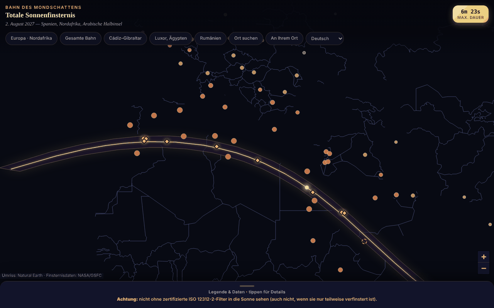

# Eclipsa-2027 — Karte der totalen Sonnenfinsternis vom 2. August 2027

[English](README.md) · [Română](README.ro.md) · [Français](README.fr.md) · [Italiano](README.it.md) · [Español](README.es.md) · [Português](README.pt.md) · **Deutsch** · [Magyar](README.hu.md)

**Version:** 1.3.6 · **Zuletzt aktualisiert:** 2026-10-23

Oberflächensprachen: **Română, English, Français, Italiano, Español, Português (PT), Deutsch, Magyar**

Interaktive Karte in einer einzigen HTML-Datei des Totalitätsstreifens (Südspanien, Nordafrika, Arabische Halbinsel), mit Dauern und partieller Bedeckung nach Städten.

**Online-App:** https://chiuta.github.io/Eclipsa-2027/

## Was es ist

Eine Offline-Karte der Finsternis vom 2. August 2027 (Maximum 6 min 23 s, Saros 136). Der Streifen und die Mittellinie stammen aus den Besselschen Elementen der NASA/GSFC (F. Espenak); die Kartenumrisse sind Natural Earth, aus Vektordaten gezeichnet (ohne Kacheln). Fehlt JavaScript, wird eine statische Variante (SVG + Tabellen) angezeigt.

## Funktionen

- Leaflet-Karte mit Totalitätsstreifen, Mittellinie und dem Punkt größter Dauer (26°49′N 31°08′E).
- 59 Städte mit partiellem Bedeckungsgrad in Prozent und Zeit des Maximums (lokale Zeitzone); 10 Orte auf oder nahe der Zugbahn mit der Dauer der Totalität (ungefähr).
- Sprungschaltflächen (Europa, gesamte Zugbahn, Cádiz–Gibraltar, Luxor, Rumänien), einklappbare Legende.
- „Ort suchen“: Gib den Namen eines Ortes aus der Liste (ohne Diakritika) oder Dezimalkoordinaten `lat, lon` ein; bei Koordinaten teilt die Anwendung lokal mit, ob der Punkt innerhalb des Totalitätsstreifens liegt und wie viele km er von der Mittellinie / vom nächstgelegenen Rand entfernt ist (bezogen auf das Streifenpolygon; Richtwert, berechnet nicht die Dauer der Totalität).
- Dauerhafte Warnung zum Augenschutz (ISO 12312-2).
- Oberfläche in 8 Sprachen (RO, EN, FR, IT, ES, PT, DE, HU): Sprachwähler in der Schaltflächenreihe (bei Browsern mit einer anderen Sprache als Rumänisch öffnet sich die Seite auf Englisch; `?lang=ro` oder `?lang=en` erzwingt die Sprache). Die Wahl wird nicht gespeichert (die Anwendung nutzt keinen Speicher); die Suche akzeptiert auch englische Städtenamen (Lisbon, Warsaw usw.). Die statische Variante ohne JavaScript bleibt auf Rumänisch.
- Die Städtemarkierungen verkleinern sich bei geringem Zoom, damit sie sich auf schmalen Bildschirmen weniger überlagern.

## Neue Funktionen (1.1.0)

Alles wird lokal berechnet, mit dem Modul `FFF.ephem` (eigene Ephemeriden, ohne Netzwerk), im Dialog „An deinem Ort“ (die Schaltfläche in der Schaltflächenreihe; er erscheint auch als „Lokale Umstände ›“ nach „Ort suchen“):

- **Lokale Umstände der Finsternis vom 2. August 2027** für jeden Ort: Kontakte C1, C2, Maximum, C3, C4 (UTC, und Ortszeit, wenn die IANA-Zeitzone bekannt ist), Größe, Verfinsterung, Dauer der Totalität und der partiellen Phase, Höhe und Azimut der Sonne, Lage relativ zum Totalitätsstreifen (innerhalb/außerhalb, Abstand zum Rand). Der Ort: Suche nach Namen (die 59 Städte, RO/EN), Koordinaten `lat, lon` oder GPS.
- **GPS mit ausdrücklicher Einwilligung, in zwei Schritten:** Die Schaltfläche „Meinen Standort verwenden (GPS)“ öffnet zuerst eine Bestätigung in der Seite; erst nach „Ja“ erfolgt eine einzige `getCurrentPosition`-Anfrage. Die Koordinaten werden weder gespeichert noch irgendwohin gesendet.
- **Countdown** bis zum nächsten Kontakt, mit der aktuellen Phase (davor, partiell, Totalität — wobei die verbleibende Zeit bis C3 heruntergezählt wird —, danach) und eine Schaltfläche **„Probelauf“**, die eine simulierte Uhr 30 s vor C2 (oder vor dem Maximum bei einer partiellen Finsternis) startet, damit du üben kannst.
- **`.ics`-Export** (Kalender): ein Termin für die gesamte Finsternis (C1–C4) und, bei Totalität, einer für die Totalität (C2–C3), mit optionalen `VALARM`-Alarmen (einen Tag und 15 Minuten vorher; 5 Minuten vor der Totalität); Zeiten in UTC, Zeilen bei 75 Oktetten gefaltet, CRLF.
- **Checkliste für sicheres Beobachten** (ISO-12312-2-Filter, der Moment, in dem das Betrachten mit bloßem Auge nur während der Totalität sicher ist, Fotografieren, Kinder, Anreise), mit Fortschritt; die Häkchen werden nicht zwischen Sitzungen gespeichert.
- **Berechneter Streifen auf der Karte:** Ein Häkchen legt über die Leaflet-Karte die in der Anwendung berechneten gepunkteten Linien (Nordgrenze, Südgrenze, Mittellinie), zusätzlich zu denen aus den eingebetteten NASA-Daten, und zeigt die Abweichung zwischen ihnen: auf dem gemeinsamen Abschnitt höchstens 3,6 km und im Mittel 0,9 km (gemessen am 14.10.2026).
- Die Oberfläche hat 8 Sprachen (RO, EN, FR, IT, ES, PT, DE, HU), die im Sprachwähler ausgewählt werden; `html[lang]` folgt der gewählten Sprache. Die langen Notizen der Anwendung bleiben nur auf Rumänisch und Englisch (in den anderen Sprachen wird Englisch angezeigt). Die Übersetzungen fr/it/es/pt/de/hu sind **automatisch und nicht von Muttersprachlern geprüft**.

## Bedienungsanleitung

1. Öffne die Seite; ziehe/zoome auf der Karte.
2. Tippe auf eine Stadt für Prozentsatz und Uhrzeit oder auf eine goldene Raute für die Dauer der Totalität.
3. Nutze die Schaltflächen oben für vordefinierte Gebiete oder „Ort suchen“ für eine Stadt aus der Liste oder für Koordinaten.
4. Öffne „Legende & Daten“ (unten) für Legende, Fakten, Sicherheit und Quellen.

## Datenschutz und Netzwerk

- Es verwendet weder localStorage/sessionStorage/IndexedDB noch Cookies oder Konten.
- Es kontaktiert keinen externen Host (CSP: `connect-src 'none'`); Leaflet ist in der Datei enthalten.
- Berechtigungen: keine beim Start; der Standort nur auf ausdrückliche Anforderung (siehe unten).

- 1.1.0: Die **Geolokalisierung** (`navigator.geolocation`) wird nur verwendet, wenn du „Meinen Standort verwenden (GPS)“ drückst und in der Seite bestätigst; anschließend fragt auch der Browser nach der Berechtigung. Der `.ics`-Export und die Daten des Kits werden über ein lokales `Blob` heruntergeladen. Es gibt keine neuen Netzwerkanfragen (CSP `connect-src 'none'` unverändert). Das Kit `fff-kit` (Module `core`, `label`, `bundle`, `ephem`) fügt die Transparenz-Schaltfläche pro Version hinzu; die Anwendung schreibt nichts in `localStorage`/`sessionStorage` (beim Start geprüft: 0 Schlüssel).

## Grenzen und Warnungen

- **Sicherheit:** Schau nicht ohne zertifizierte ISO-12312-2-Filter in die Sonne (keine Sonnenbrille, kein Fernglas/Fernrohr ohne Sonnenfilter); mit bloßem Auge nur während der vollständigen Totalität.
- Informative und ungefähre Werte. Unabhängig aus den Besselschen Elementen der NASA neu berechnet (ΔT = 71,7 s): Die partielle Bedeckung der 59 Städte weicht im Mittel um 0,05 Prozentpunkte ab (max. 0,3); die Totalitätsdauern gelten für das Stadtzentrum und schwanken um Dutzende Sekunden. Die Zahl „~89 Mio. Menschen“ ist ungeprüft.
- Orte am Rand des Streifens (z. B. Sanaa, ~2–2,5 min) reagieren empfindlich auf den genauen Standort; prüfe offizielle Quellen.
- Persönliches, inoffizielles Projekt.

- **Neue Funktionen, echte Grenzen.** Die lokalen Kontakte werden für Meereshöhe berechnet (die eingegebene Höhe wird angewandt, Relief und lokaler Horizont nicht); die Übereinstimmung mit der unabhängigen Referenz (JPL DE421, topozentrische Separation) beträgt ≈ 1 s im Maximum und ≤ 3 s bei den Kontakten an 10 Testorten, doch ΔT (Erdrotation) hat 2027 eine Unsicherheit von ≈ ±1 s, und der Mondrand ist nicht modelliert (Bailys Perlen, Schattenbänder). Die Totalitätsdauer am Rand des Streifens ist sehr empfindlich gegenüber dem genauen Ort. Die Anwendung warnt, wenn ein Kontakt unter dem Horizont stattfindet oder wenn der Ort weniger als 15 km vom Rand entfernt ist.
- **Der Countdown nutzt die Geräteuhr**, keine offizielle Zeitquelle: Prüfe die Uhrzeit deines Telefons. Die Anwendung ist kein Sicherheitsinstrument; ISO-12312-2-Filter und die Anweisungen der Behörden bleiben verbindlich. Es wird keine medizinische Beratung geboten.
- **Der berechnete Streifen** hat eine Näherungsunschärfe (5-Minuten-Schritt entlang der Zugbahn, Vergleich mit den eingebetteten NASA-Daten); er ersetzt keine offiziellen Daten.

## Tests

`node tests/fff-r8.test.mjs` (Playwright aus `/opt/node-tools`, lokales Chromium, Netzwerk gesperrt; `tests/_lib.mjs` enthält die gemeinsamen Hilfsfunktionen). Die Referenzwerte stehen in `tests/ref-c3a.json`: lokale Umstände für 10 Referenzorte (Kontakte C1–C4, Dauer, Verfinsterung, Sonnenhöhe; JPL DE421, aus `fff-kit/test/ref`), die Zeitpunkte von Auf-/Untergang/Durchgang (Sonne, Mond; 5 Orte × 4 Daten), 56 Phasenzeitpunkte und 54 Alt/Az-Positionen, unabhängig mit **pyephem 4.2.1** berechnet (nur offline zur Erzeugung der Zahlen verwendet; es ist nicht Teil der Anwendung). Jeder Test hat seine Schwelle im Code stehen; der Barrierefreiheitstest (axe-core, `bypassCSP`) läuft auch in geöffneten Dialogen/Panels, bei 1280×800 und 360×740.

## Lokale Ausführung / offline

Lade `index.html` herunter und öffne sie in einem Browser; sie funktioniert ohne Internet.

## Verlauf / Changelog

### 1.3.5 — 2026-10-22

fff-kit 1.1.4: Touch-Ziele und Mindestschriftgröße. Touch-Ziele/Text in der App korrigiert.

### 1.3.4 — 2026-10-22

fff-kit 1.1.2: PBKDF2 mit 600.000 Iterationen, Schutz vor Clickjacking.

### 1.3.3 — 2026-10-22
- Barrierefreiheit: genau eine H1 auf der Seite (die statische Ansicht ohne JavaScript wird nach dem Start der Karte aus dem DOM entfernt); die Markierungen für Städte und Bandränder auf der Karte haben größere Touch-Flächen (24 px).
- Mobil: Der Text ist mindestens 12 px groß, und Schaltflächen und Felder haben auf schmalen Bildschirmen größere Touch-Flächen.

### 1.2.0 — 2026-10-19
- Neu: Link „↗ TerRa“ nach dem lokalen Ergebnis — öffnet TerRa (2D-Karte) zum Maximum der Finsternis (lokal, oder global, wenn die Finsternis nicht sichtbar ist), mit dem gewählten Ort als „Mein Standort“. Die Koordinaten (auf ~1 km gerundet) erscheinen nur in der Adresse des neuen Tabs; sie werden nirgendwohin gesendet.

### 1.1.0 — 2026-10-14
- Neu: der Dialog „An deinem Ort“ (lokale Umstände, Countdown + Probelauf, `.ics`-Export, Checkliste, berechneter Streifen auf der Karte, GPS mit zweistufiger Einwilligung); Sprachzyklus RO/EN/HU/DE für die neuen Funktionen; `FFF.ephem` und das Kit `fff-kit` (`core`, `label`, `bundle`, `ephem`) integriert; `tests/fff-r8.test.mjs` (83 Prüfungen); Screenshot aktualisiert (die neue Schaltfläche). Die NASA-Daten und der Rest der Anwendung wurden nicht verändert (Vorher-/Nachher-Vergleich bei 1280×800: der einzige sichtbare Unterschied ist die neue Schaltfläche).

- 1.0.0 — 2026-10-12: Version und Datum der letzten Aktualisierung werden in der App angezeigt
- Runde 7: zweisprachige RO/EN-Oberfläche (Titel, Legende, Sicherheitswarnung, Quellen, Kartenfenster und Suchergebnisse); nach Zoom skalierte Markierungen (besser lesbare Karte bei 360 px); Screenshot aktualisiert (die Schaltfläche „EN“).
- „Ort suchen“ hinzugefügt (Stadt aus der Liste oder Koordinaten → innerhalb/außerhalb des Streifens und Richtwert-Entfernungen); CSP: `script-src` per SHA-256-Hash, ohne `'unsafe-inline'`; Screenshot aktualisiert (die neue Schaltfläche).
- Karte, Kopfzeile und Legende sind nun semantische Landmarken (`main`, `header`, `aside`); axe-core: 0 Verstöße bei 1280 und 360 px (und auch die statische Variante hat ihren Inhalt in `main`).
- Das Ereignis (2. August 2027) liegt zu diesem Datum noch in der Zukunft; die NASA/GSFC-Daten wurden nicht verändert.

## Lizenz

Lizenz: MIT — siehe Datei `LICENSE`. Enthält Leaflet 1.9.4 (BSD-2-Clause, © Vladimir Agafonkin) und Natural-Earth-Daten (gemeinfrei).

## Autor

Alexio — Alexandru-Ionuț Chiuță, Kontakt: alexio@trom.tf

## Zusammenfassung
Offline-Leaflet-Karte in einer einzigen Datei der totalen Sonnenfinsternis vom 2. August 2027: Totalitätsstreifen, Mittellinie, Punkt größter Dauer, partielle Bedeckung für 59 Städte. Streifendaten aus den Besselschen Elementen der NASA; Städtewerte unabhängig nachgeprüft (mittlere Abweichung 0,05 Prozentpunkte). Deutlich sichtbare Warnung zum Augenschutz (ISO 12312-2). Kein Speicher, keine Netzwerkanfragen.
