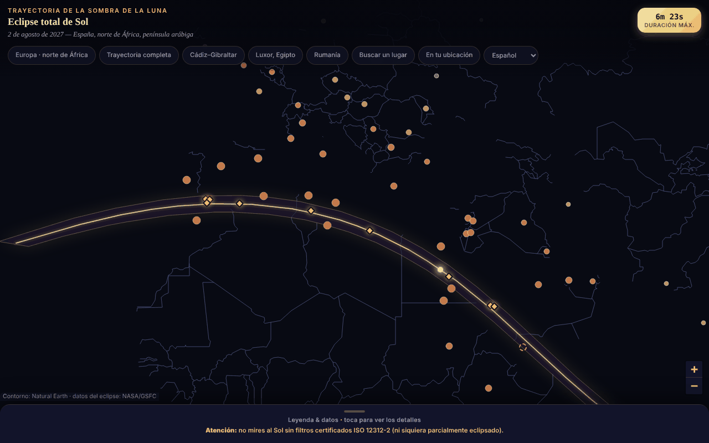

# Eclipsa-2027 — mapa del eclipse total de Sol del 2 de agosto de 2027

[English](README.md) · [Română](README.ro.md) · [Français](README.fr.md) · [Italiano](README.it.md) · **Español** · [Português](README.pt.md) · [Deutsch](README.de.md) · [Magyar](README.hu.md)

**Versión:** 2.2.1 · **Última actualización:** 2026-10-31

Idiomas de la interfaz: **Română, English, Français, Italiano, Español, Português (PT), Deutsch, Magyar**

Mapa interactivo, en un solo archivo HTML, de la banda de totalidad (sur de España, norte de África, península arábiga), con duraciones y cobertura parcial por ciudades.

**Aplicación en línea:** https://chiuta.github.io/Eclipsa-2027/

## Qué es

Un mapa sin conexión del eclipse del 2 de agosto de 2027 (máximo 6 min 23 s, Saros 136). La banda y la línea central proceden de los elementos besselianos de la NASA/GSFC (F. Espenak); el contorno del mapa es Natural Earth, dibujado a partir de datos vectoriales (sin teselas). Si falta JavaScript, se muestra una variante estática (SVG + tablas).

## Funciones

- Mapa Leaflet con banda de totalidad, línea central y punto de máxima duración (26°49′N 31°08′E).
- 59 ciudades con porcentaje de cobertura parcial y hora del máximo (huso horario local); 10 lugares sobre el trazado o cerca de él con la duración de la totalidad (aproximada).
- Botones de salto (Europa, trazado completo, Cádiz–Gibraltar, Luxor, Rumanía), leyenda plegable.
- «Buscar un lugar»: escribe el nombre de un lugar de la lista (sin signos diacríticos) o coordenadas decimales `lat, lon`; para coordenadas, la aplicación indica, en local, si el punto está dentro de la banda de totalidad y a cuántos km se encuentra de la línea central / del borde más cercano (respecto al polígono de la banda; orientativo, no calcula la duración de la totalidad).
- Advertencia permanente de seguridad ocular (ISO 12312-2).
- Interfaz en 8 idiomas (RO, EN, FR, IT, ES, PT, DE, HU): selector de idioma en la fila de botones (en navegadores con un idioma distinto del rumano se abre en inglés; `?lang=ro` o `?lang=en` fuerza el idioma). La elección no se guarda (la aplicación no usa almacenamiento); la búsqueda acepta también los nombres ingleses de las ciudades (Lisbon, Warsaw, etc.). La variante estática, sin JavaScript, sigue en rumano.
- Los marcadores de las ciudades se reducen con zoom bajo, para solaparse menos en pantallas estrechas.

## Funciones nuevas (1.1.0)

Todo se calcula en local, con el módulo `FFF.ephem` (efemérides propias, sin red), en el cuadro «En tu ubicación» (el botón de la fila de botones; aparece también como «Circunstancias locales ›» tras «Buscar un lugar»):

- **Circunstancias locales del eclipse del 2 de agosto de 2027** para cualquier lugar: contactos C1, C2, máximo, C3, C4 (UTC, y hora local cuando se conoce el huso horario IANA), magnitud, oscurecimiento, duración de la totalidad y de la fase parcial, altura y acimut del Sol, posición respecto a la banda de totalidad (dentro/fuera, distancia al borde). El lugar: búsqueda por nombre (las 59 ciudades, RO/EN), coordenadas `lat, lon` o GPS.
- **GPS con consentimiento explícito, en dos pasos:** el botón «Usar mi ubicación (GPS)» abre primero una confirmación en la página; solo tras «Sí» se hace una única petición `getCurrentPosition`. Las coordenadas no se guardan ni se envían a ninguna parte.
- **Cuenta atrás** hasta el siguiente contacto, con la fase actual (antes, parcial, totalidad — donde cuenta el tiempo restante hasta C3 —, después) y un botón **«Ensayo»** que inicia un reloj simulado 30 s antes de C2 (o del máximo, en un eclipse parcial) para practicar.
- **Exportación `.ics`** (calendario): un evento para todo el eclipse (C1–C4) y, en caso de totalidad, uno para la totalidad (C2–C3), con alarmas `VALARM` opcionales (un día y 15 minutos antes; 5 minutos antes de la totalidad); horas en UTC, líneas plegadas a 75 octetos, CRLF.
- **Lista de comprobación para la observación segura** (filtros ISO 12312-2, el momento en que mirar a simple vista es seguro solo durante la totalidad, fotografía, niños, desplazamiento), con progreso; las marcas no se guardan entre sesiones.
- **Banda calculada en el mapa:** una casilla superpone al mapa Leaflet las líneas de puntos (límite norte, límite sur, línea central) calculadas en la aplicación, además de las de los datos NASA incorporados, y muestra la desviación entre ellas: en el tramo común, como máximo 3,6 km y de media 0,9 km (medido el 14.10.2026).
- La interfaz tiene 8 idiomas (RO, EN, FR, IT, ES, PT, DE, HU), que se eligen en el selector de idioma; `html[lang]` sigue el idioma elegido. Las notas largas de la aplicación permanecen solo en rumano e inglés (en los demás idiomas se ve el inglés). Las traducciones fr/it/es/pt/de/hu son **automáticas y no verificadas por hablantes nativos**.

## Guía de uso

1. Abre la página; arrastra/amplía en el mapa.
2. Toca una ciudad para ver porcentaje y hora, o un rombo dorado para la duración de la totalidad.
3. Usa los botones de arriba para zonas predefinidas o «Buscar un lugar» para una ciudad de la lista o para coordenadas.
4. Abre «Leyenda y datos» (abajo) para la leyenda, los datos, la seguridad y las fuentes.

## Privacidad y red

- No usa localStorage/sessionStorage/IndexedDB, cookies ni cuentas.
- No contacta con ningún host externo (CSP: `connect-src 'none'`); Leaflet está incluido en el archivo.
- Permisos: ninguno al inicio; la ubicación solo bajo petición explícita (véase más abajo).

- 1.1.0: la **geolocalización** (`navigator.geolocation`) se usa solo si pulsas «Usar mi ubicación (GPS)» y confirmas en la página; después el navegador pide también el permiso. La exportación `.ics` y los datos del kit se descargan mediante un `Blob` local. No hay nuevas peticiones de red (CSP `connect-src 'none'` sin cambios). El kit `fff-kit` (módulos `core`, `label`, `bundle`, `ephem`) añade el botón de transparencia por versión; la aplicación no escribe nada en `localStorage`/`sessionStorage` (comprobado al inicio: 0 claves).

## Límites y advertencias

- **Seguridad:** no mires al Sol sin filtros certificados ISO 12312-2 (ni gafas de sol, ni prismáticos/telescopio sin filtro solar); a simple vista solo durante la totalidad completa.
- Valores informativos y aproximados. Recalculados de forma independiente a partir de los elementos besselianos de la NASA (ΔT = 71,7 s): la cobertura parcial de las 59 ciudades difiere de media en 0,05 puntos porcentuales (máx. 0,3); las duraciones de la totalidad son para el centro de la ciudad y varían en decenas de segundos. La cifra «~89 millones de personas» no está verificada.
- Los lugares en el borde de la banda (p. ej. Saná, ~2–2,5 min) son sensibles a la ubicación exacta; comprueba en fuentes oficiales.
- Proyecto personal, no oficial.

- **Funciones nuevas, límites reales.** Los contactos locales se calculan para el nivel del mar (la altitud introducida se aplica, el relieve y el horizonte local no); la concordancia con la referencia independiente (JPL DE421, separación topocéntrica) es de ≈ 1 s en el máximo y ≤ 3 s en los contactos sobre 10 lugares de prueba, pero ΔT (rotación de la Tierra) tiene una incertidumbre de ≈ ±1 s en 2027, y el borde de la Luna no está modelado (perlas de Baily, bandas de sombra). La duración de la totalidad en el borde de la banda es muy sensible a la ubicación exacta. La aplicación avisa cuando un contacto ocurre bajo el horizonte o cuando el lugar está a menos de 15 km del borde.
- **La cuenta atrás usa el reloj del dispositivo**, no una fuente horaria oficial: comprueba la hora del teléfono. La aplicación no es un instrumento de seguridad; los filtros ISO 12312-2 y las instrucciones de las autoridades siguen siendo obligatorios. No se ofrece consejo médico.
- **La banda calculada** tiene un margen de aproximación (paso de 5 minutos a lo largo del trazado, comparación con los datos NASA incorporados); no sustituye a los datos oficiales.

## Pruebas

`node tests/fff-r8.test.mjs` (Playwright desde `/opt/node-tools`, Chromium local, red bloqueada; `tests/_lib.mjs` contiene las utilidades comunes). Los valores de referencia están en `tests/ref-c3a.json`: circunstancias locales para 10 lugares de referencia (contactos C1–C4, duración, oscurecimiento, altura del Sol; JPL DE421, de `fff-kit/test/ref`), los instantes de salida/puesta/tránsito (Sol, Luna; 5 lugares × 4 fechas), 56 instantes de fase y 54 posiciones alt/az, calculados de forma independiente con **pyephem 4.2.1** (usado solo sin conexión para generar los números; no forma parte de la aplicación). Cada prueba tiene su umbral escrito en el código; la prueba de accesibilidad (axe-core, `bypassCSP`) se ejecuta también en diálogos/paneles abiertos, a 1280×800 y 360×740.

## Ejecución local / offline

Descarga `index.html` y ábrelo en un navegador; funciona sin internet.

## Historial / Changelog

### 1.3.5 — 2026-10-22

fff-kit 1.1.4: áreas táctiles y texto mínimo. Áreas táctiles/texto corregidos en la aplicación.

### 1.3.4 — 2026-10-22

fff-kit 1.1.2: PBKDF2 con 600.000 iteraciones, protección anti-clickjacking.

### 1.3.3 — 2026-10-22
- Accesibilidad: exactamente un solo H1 en la página (la vista estática sin JavaScript se retira del DOM cuando el mapa arranca); los marcadores de ciudades y de los bordes de la franja en el mapa tienen áreas táctiles mayores (24 px).
- Móvil: el texto mide al menos 12 px y los botones y campos tienen áreas táctiles mayores en pantallas estrechas.

### 1.2.0 — 2026-10-19
- Nuevo: enlace «↗ TerRa» tras el resultado local — abre TerRa (mapa 2D) en el máximo del eclipse (local, o global si el eclipse no se ve), con el lugar elegido como «Mi ubicación». Las coordenadas (redondeadas a ~1 km) aparecen solo en la dirección de la nueva pestaña; no se envían a ninguna parte.

### 1.1.0 — 2026-10-14
- Nuevo: el cuadro «En tu ubicación» (circunstancias locales, cuenta atrás + ensayo, exportación `.ics`, lista de comprobación, banda calculada en el mapa, GPS con consentimiento en dos pasos); ciclo de idiomas RO/EN/HU/DE para las funciones nuevas; `FFF.ephem` y el kit `fff-kit` (`core`, `label`, `bundle`, `ephem`) integrados; `tests/fff-r8.test.mjs` (83 comprobaciones); captura de pantalla actualizada (el botón nuevo). Los datos NASA y el resto de la aplicación no se modificaron (comparación antes/después a 1280×800: la única diferencia visible es el botón nuevo).

- 1.0.0 — 2026-10-12: la versión y la fecha de la última actualización se muestran en la aplicación
- Ronda 7: interfaz bilingüe RO/EN (títulos, leyenda, advertencia de seguridad, fuentes, ventanas del mapa y resultados de búsqueda); marcadores escalados según el zoom (mapa más legible a 360 px); captura de pantalla actualizada (el botón «EN»).
- Añadido «Buscar un lugar» (ciudad de la lista o coordenadas → dentro/fuera de la banda y distancias orientativas); CSP: `script-src` con hash SHA-256, sin `'unsafe-inline'`; captura de pantalla actualizada (el botón nuevo).
- El mapa, la cabecera y la leyenda son ahora puntos de referencia semánticos (`main`, `header`, `aside`); axe-core: 0 infracciones a 1280 y 360 px (y la variante estática también tiene su contenido en `main`).
- El evento (2 de agosto de 2027) sigue siendo futuro a esta fecha; los datos NASA/GSFC no se modificaron.

## Licencia

Licencia: MIT — véase el archivo `LICENSE`. Incluye Leaflet 1.9.4 (BSD-2-Clause, © Vladimir Agafonkin) y datos de Natural Earth (dominio público).

## Autor

Alexio — Alexandru-Ionuț Chiuță, contacto: alexio@trom.tf

## Resumen

Mapa Leaflet sin conexión, en un solo archivo, del eclipse total de Sol del 2 de agosto de 2027: banda de totalidad, línea central, punto de máxima duración, cobertura parcial para 59 ciudades. Datos de la banda a partir de los elementos besselianos de la NASA; valores de las ciudades reverificados de forma independiente (desviación media de 0,05 puntos porcentuales). Advertencia destacada sobre seguridad ocular (ISO 12312-2). Sin almacenamiento, sin peticiones de red.
