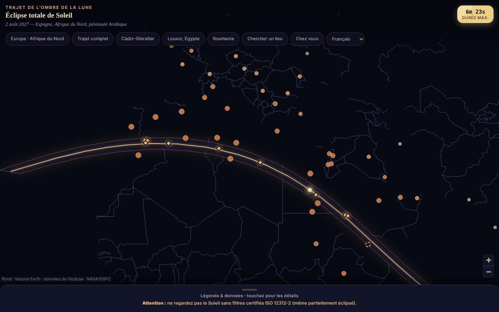

# Eclipsa-2027 — carte de l'éclipse totale de Soleil du 2 août 2027

[English](README.md) · [Română](README.ro.md) · **Français** · [Italiano](README.it.md) · [Español](README.es.md) · [Português](README.pt.md) · [Deutsch](README.de.md) · [Magyar](README.hu.md)

**Version :** 1.3.3 · **Dernière mise à jour :** 2026-10-22

Langues de l'interface : **Română, English, Français, Italiano, Español, Português (PT), Deutsch, Magyar**

Carte interactive, dans un seul fichier HTML, de la bande de totalité (sud de l'Espagne, Afrique du Nord, péninsule Arabique), avec les durées et la couverture partielle par ville.

**Application en ligne :** https://chiuta.github.io/Eclipsa-2027/

## Présentation

Une carte hors ligne de l'éclipse du 2 août 2027 (maximum 6 min 23 s, Saros 136). La bande et la ligne centrale proviennent des éléments besséliens de la NASA/GSFC (F. Espenak) ; le tracé de la carte est Natural Earth, dessiné à partir de données vectorielles (sans tuiles). Si JavaScript est absent, une variante statique (SVG + tableaux) s'affiche.

## Fonctionnalités

- Carte Leaflet avec la bande de totalité, la ligne centrale et le point de durée maximale (26°49′N 31°08′E).
- 59 villes avec pourcentage de couverture partielle et heure du maximum (fuseau local) ; 10 lieux sur ou près du tracé avec la durée de la totalité (approximative).
- Boutons de saut (Europe, tracé complet, Cadix–Gibraltar, Louxor, Roumanie), légende repliable.
- « Rechercher un lieu » : saisissez le nom d'un lieu de la liste (sans signes diacritiques) ou des coordonnées décimales `lat, lon` ; pour des coordonnées, l'application indique, en local, si le point est à l'intérieur de la bande de totalité et à combien de km il se trouve de la ligne centrale / du bord le plus proche (par rapport au polygone de la bande ; indicatif, ne calcule pas la durée de la totalité).
- Avertissement permanent de sécurité oculaire (ISO 12312-2).
- Interface en 8 langues (RO, EN, FR, IT, ES, PT, DE, HU) : sélecteur de langue dans la rangée de boutons (pour les navigateurs dont la langue n'est pas le roumain, la page s'ouvre en anglais ; `?lang=ro` ou `?lang=en` force la langue). Le choix n'est pas enregistré (l'application n'utilise aucun stockage) ; la recherche accepte aussi les noms anglais des villes (Lisbon, Warsaw, etc.). La variante statique, sans JavaScript, reste en roumain.
- Les marqueurs des villes rétrécissent à faible zoom, afin de se chevaucher moins sur les écrans étroits.

## Nouvelles fonctionnalités (1.1.0)

Tout est calculé en local, avec le module `FFF.ephem` (éphémérides propres, sans réseau), dans la boîte de dialogue « À votre position » (le bouton de la rangée de boutons ; elle apparaît aussi sous la forme « Circonstances locales › » après « Rechercher un lieu ») :

- **Circonstances locales de l'éclipse du 2 août 2027** pour n'importe quel lieu : contacts C1, C2, maximum, C3, C4 (UTC, et heure locale lorsque le fuseau horaire IANA est connu), magnitude, obscuration, durée de la totalité et de la phase partielle, hauteur et azimut du Soleil, position par rapport à la bande de totalité (dedans/dehors, distance au bord). Le lieu : recherche par nom (les 59 villes, RO/EN), coordonnées `lat, lon`, ou GPS.
- **GPS avec consentement explicite, en deux temps :** le bouton « Utiliser ma position (GPS) » ouvre d'abord une confirmation dans la page ; ce n'est qu'après « Oui » qu'une unique requête `getCurrentPosition` est effectuée. Les coordonnées ne sont ni enregistrées ni envoyées nulle part.
- **Compte à rebours** jusqu'au prochain contact, avec la phase en cours (avant, partielle, totalité — où il décompte le temps restant jusqu'à C3 —, après) et un bouton **« Répétition »** qui lance une horloge simulée 30 s avant C2 (ou avant le maximum, pour une éclipse partielle) afin de s'exercer.
- **Export `.ics`** (calendrier) : un événement pour toute l'éclipse (C1–C4) et, en cas de totalité, un pour la totalité (C2–C3), avec des alarmes `VALARM` facultatives (un jour et 15 minutes avant ; 5 minutes avant la totalité) ; heures en UTC, lignes repliées à 75 octets, CRLF.
- **Liste de contrôle pour l'observation en sécurité** (filtres ISO 12312-2, moment où l'observation à l'œil nu n'est sûre que pendant la totalité, photographie, enfants, déplacement), avec progression ; les coches ne sont pas enregistrées entre les sessions.
- **Bande calculée sur la carte :** une case à cocher superpose à la carte Leaflet les lignes pointillées (limite nord, limite sud, ligne centrale) calculées dans l'application, en plus de celles issues des données NASA intégrées, et affiche l'écart entre elles : sur la portion commune, 3,6 km au maximum et 0,9 km en moyenne (mesuré le 14.10.2026).
- L'interface compte 8 langues (RO, EN, FR, IT, ES, PT, DE, HU), choisies dans le sélecteur de langue ; `html[lang]` suit la langue choisie. Les longues notes de l'application restent uniquement en roumain et en anglais (dans les autres langues, c'est l'anglais qui s'affiche). Les traductions fr/it/es/pt/de/hu sont **automatiques et non vérifiées par des locuteurs natifs**.

## Mode d'emploi

1. Ouvrez la page ; faites glisser/zoomez sur la carte.
2. Touchez une ville pour le pourcentage et l'heure, ou un losange doré pour la durée de la totalité.
3. Utilisez les boutons du haut pour des zones prédéfinies ou « Rechercher un lieu » pour une ville de la liste ou pour des coordonnées.
4. Ouvrez « Légende et données » (en bas) pour la légende, les faits, la sécurité et les sources.

## Confidentialité et réseau

- N'utilise ni localStorage/sessionStorage/IndexedDB, ni cookies, ni comptes.
- Ne contacte aucun hôte externe (CSP : `connect-src 'none'`) ; Leaflet est inclus dans le fichier.
- Autorisations : aucune au démarrage ; la position uniquement sur demande explicite (voir ci-dessous).

- 1.1.0 : la **géolocalisation** (`navigator.geolocation`) n'est utilisée que si vous appuyez sur « Utiliser ma position (GPS) » et confirmez dans la page ; le navigateur demande ensuite lui aussi l'autorisation. L'export `.ics` et les données du kit sont téléchargés via un `Blob` local. Il n'y a aucune nouvelle requête réseau (CSP `connect-src 'none'` inchangée). Le kit `fff-kit` (modules `core`, `label`, `bundle`, `ephem`) ajoute le bouton de transparence par version ; l'application n'écrit rien dans `localStorage`/`sessionStorage` (vérifié au démarrage : 0 clé).

## Limites et avertissements

- **Sécurité :** ne regardez pas le Soleil sans filtres certifiés ISO 12312-2 (ni lunettes de soleil, ni jumelles/lunette sans filtre solaire) ; à l'œil nu uniquement pendant la totalité complète.
- Valeurs indicatives et approximatives. Recalculées de façon indépendante à partir des éléments besséliens de la NASA (ΔT = 71,7 s) : la couverture partielle des 59 villes diffère en moyenne de 0,05 point de pourcentage (max. 0,3) ; les durées de totalité sont celles du centre-ville et varient de plusieurs dizaines de secondes. Le chiffre « ~89 millions de personnes » n'est pas vérifié.
- Les lieux situés au bord de la bande (p. ex. Sanaa, ~2–2,5 min) sont sensibles à l'emplacement exact ; vérifiez auprès de sources officielles.
- Projet personnel, non officiel.

- **Nouvelles fonctionnalités, limites réelles.** Les contacts locaux sont calculés pour le niveau de la mer (l'altitude saisie est appliquée, le relief et l'horizon local ne le sont pas) ; la concordance avec la référence indépendante (JPL DE421, séparation topocentrique) est de ≈ 1 s au maximum et ≤ 3 s aux contacts sur 10 lieux de test, mais ΔT (rotation de la Terre) présente une incertitude de ≈ ±1 s en 2027, et le bord de la Lune n'est pas modélisé (grains de Baily, bandes d'ombre). La durée de la totalité au bord de la bande est très sensible à l'emplacement exact. L'application avertit lorsqu'un contact a lieu sous l'horizon ou lorsque le lieu se trouve à moins de 15 km du bord.
- **Le compte à rebours utilise l'horloge de l'appareil**, et non une source horaire officielle : vérifiez l'heure de votre téléphone. L'application n'est pas un instrument de sécurité ; les filtres ISO 12312-2 et les consignes des autorités restent obligatoires. Aucun conseil médical n'est fourni.
- **La bande calculée** comporte une marge d'approximation (pas de 5 minutes le long du tracé, comparaison avec les données NASA intégrées) ; elle ne remplace pas les données officielles.

## Tests

`node tests/fff-r8.test.mjs` (Playwright depuis `/opt/node-tools`, Chromium local, réseau bloqué ; `tests/_lib.mjs` contient les utilitaires communs). Les valeurs de référence sont dans `tests/ref-c3a.json` : circonstances locales pour 10 lieux de référence (contacts C1–C4, durée, obscuration, hauteur du Soleil ; JPL DE421, depuis `fff-kit/test/ref`), les instants de lever/coucher/passage (Soleil, Lune ; 5 lieux × 4 dates), 56 instants de phase et 54 positions alt/az, calculés de façon indépendante avec **pyephem 4.2.1** (utilisé uniquement hors ligne pour générer les nombres ; il ne fait pas partie de l'application). Chaque test a son seuil écrit dans le code ; le test d'accessibilité (axe-core, `bypassCSP`) s'exécute aussi dans les boîtes de dialogue/panneaux ouverts, à 1280×800 et 360×740.

## Exécution locale / hors ligne

Téléchargez `index.html` et ouvrez-le dans un navigateur ; il fonctionne sans internet.

## Historique / Changelog

### 1.3.3 — 2026-10-22
- Accessibilité : exactement un seul H1 dans la page (la vue statique sans JavaScript est retirée du DOM une fois la carte démarrée) ; les repères des villes et des bords de la bande sur la carte ont des cibles tactiles plus grandes (24 px).
- Mobile : le texte fait au moins 12 px et les boutons et champs ont des cibles tactiles plus grandes sur les écrans étroits.

### 1.2.0 — 2026-10-19
- Nouveau : lien « ↗ TerRa » après le résultat local — ouvre TerRa (carte 2D) au maximum de l'éclipse (local, ou global si l'éclipse n'est pas visible), avec le lieu choisi comme « Ma position ». Les coordonnées (arrondies à ~1 km) n'apparaissent que dans l'adresse du nouvel onglet ; elles ne sont envoyées nulle part.

### 1.1.0 — 2026-10-14
- Nouveau : la boîte de dialogue « À votre position » (circonstances locales, compte à rebours + répétition, export `.ics`, liste de contrôle, bande calculée sur la carte, GPS avec consentement en deux temps) ; cycle de langues RO/EN/HU/DE pour les nouvelles fonctionnalités ; `FFF.ephem` et le kit `fff-kit` (`core`, `label`, `bundle`, `ephem`) intégrés ; `tests/fff-r8.test.mjs` (83 vérifications) ; capture d'écran mise à jour (le nouveau bouton). Les données NASA et le reste de l'application n'ont pas été modifiés (comparaison avant/après à 1280×800 : la seule différence visible est le nouveau bouton).

- 1.0.0 — 2026-10-12 : la version et la date de dernière mise à jour sont affichées dans l'application
- Tour 7 : interface bilingue RO/EN (titres, légende, avertissement de sécurité, sources, fenêtres de la carte et résultats de recherche) ; marqueurs mis à l'échelle selon le zoom (carte plus lisible à 360 px) ; capture d'écran mise à jour (le bouton « EN »).
- Ajout de « Rechercher un lieu » (ville de la liste ou coordonnées → dans/hors de la bande et distances indicatives) ; CSP : `script-src` sur un hachage SHA-256, sans `'unsafe-inline'` ; capture d'écran mise à jour (le nouveau bouton).
- La carte, l'en-tête et la légende sont désormais des repères sémantiques (`main`, `header`, `aside`) ; axe-core : 0 violation à 1280 et 360 px (et la variante statique a aussi son contenu dans `main`).
- L'événement (2 août 2027) est encore à venir à cette date ; les données NASA/GSFC n'ont pas été modifiées.

## Licence

Licence : MIT — voir le fichier `LICENSE`. Inclut Leaflet 1.9.4 (BSD-2-Clause, © Vladimir Agafonkin) et les données Natural Earth (domaine public).

## Auteur

Alexio — Alexandru-Ionuț Chiuță, contact : alexio@trom.tf

## Résumé
Carte Leaflet hors ligne, en un seul fichier, de l'éclipse totale de Soleil du 2 août 2027 : bande de totalité, ligne centrale, point de durée maximale, couverture partielle pour 59 villes. Données de la bande issues des éléments besséliens de la NASA ; valeurs des villes revérifiées de façon indépendante (écart moyen de 0,05 point de pourcentage). Avertissement bien visible sur la sécurité oculaire (ISO 12312-2). Aucun stockage, aucune requête réseau.
