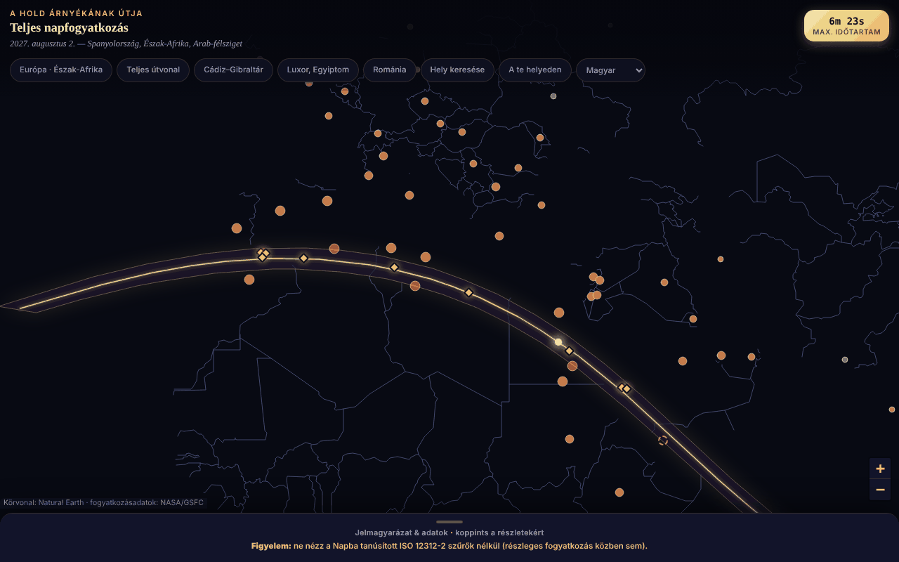

# Eclipsa-2027 — a 2027. augusztus 2-i teljes napfogyatkozás térképe

[English](README.md) · [Română](README.ro.md) · [Français](README.fr.md) · [Italiano](README.it.md) · [Español](README.es.md) · [Português](README.pt.md) · [Deutsch](README.de.md) · **Magyar**

**Verzió:** 1.3.4 · **Utolsó frissítés:** 2026-10-22

A felület nyelvei: **Română, English, Français, Italiano, Español, Português (PT), Deutsch, Magyar**

Interaktív térkép egyetlen HTML-fájlban a teljesség sávjáról (Dél-Spanyolország, Észak-Afrika, Arab-félsziget), városonkénti időtartamokkal és részleges fedéssel.

**Online alkalmazás:** https://chiuta.github.io/Eclipsa-2027/

## Mi ez

Offline térkép a 2027. augusztus 2-i napfogyatkozásról (maximum 6 perc 23 mp, Saros 136). A sáv és a középvonal a NASA/GSFC bessel-elemeiből származik (F. Espenak); a térkép körvonala Natural Earth, vektoradatokból rajzolva (csempék nélkül). Ha a JavaScript hiányzik, statikus változat jelenik meg (SVG + táblázatok).

## Funkciók

- Leaflet térkép a teljesség sávjával, a középvonallal és a legnagyobb időtartamú ponttal (26°49′É 31°08′K).
- 59 város a részleges fedés százalékával és a maximum idejével (helyi időzóna); 10 hely a nyomvonalon vagy annak közelében a teljesség időtartamával (hozzávetőleges).
- Ugrógombok (Európa, teljes nyomvonal, Cádiz–Gibraltár, Luxor, Románia), összecsukható jelmagyarázat.
- „Hely keresése”: írd be a listában szereplő hely nevét (ékezetek nélkül) vagy tizedes koordinátákat `lat, lon`; koordináták esetén az alkalmazás helyben megmondja, hogy a pont a teljesség sávján belül van-e, és hány km-re van a középvonaltól / a legközelebbi széltől (a sáv sokszögéhez viszonyítva; tájékoztató jellegű, nem számolja a teljesség időtartamát).
- Állandó szemvédelmi figyelmeztetés (ISO 12312-2).
- 8 nyelvű felület (RO, EN, FR, IT, ES, PT, DE, HU): a nyelvválasztó a gombsorban (a nem román nyelvű böngészőkben angolul nyílik meg; a `?lang=ro` vagy `?lang=en` erőlteti a nyelvet). A választás nem kerül mentésre (az alkalmazás nem használ tárolást); a keresés elfogadja a városok angol nevét is (Lisbon, Warsaw stb.). A statikus, JavaScript nélküli változat román marad.
- A városjelölők kis nagyításnál összezsugorodnak, hogy keskeny képernyőkön kevésbé fedjék egymást.

## Új funkciók (1.1.0)

Mind helyben számolódik, az `FFF.ephem` modullal (saját efemeridák, hálózat nélkül), a „A helyeden” párbeszédablakban (a gombsor gombja; a „Hely keresése” után „Helyi körülmények ›” néven is megjelenik):

- **A 2027. augusztus 2-i napfogyatkozás helyi körülményei** bármely helyre: C1, C2, maximum, C3, C4 érintési pontok (UTC, és helyi idő, ha az IANA időzóna ismert), magnitúdó, fedettség (obszkuráció), a teljesség és a részleges fázis időtartama, a Nap magassága és azimutja, helyzet a teljesség sávjához képest (belül/kívül, távolság a széltől). A hely: keresés név szerint (az 59 város, RO/EN), `lat, lon` koordináták vagy GPS.
- **GPS kifejezett hozzájárulással, két lépésben:** a „Saját helyzetem használata (GPS)” gomb először az oldalon belül kér megerősítést; csak az „Igen” után történik egyetlen `getCurrentPosition` kérés. A koordinátákat nem mentjük, és nem küldjük sehova.
- **Visszaszámlálás** a következő érintési pontig, az aktuális fázissal (előtte, részleges, teljesség — ahol a C3-ig hátralévő időt számolja —, utána) és egy **„Próba”** gombbal, amely szimulált órát indít 30 másodperccel C2 előtt (vagy a maximum előtt, részleges fogyatkozásnál) a gyakorláshoz.
- **`.ics`-export** (naptár): egy esemény a teljes fogyatkozásra (C1–C4), teljesség esetén pedig egy a teljességre (C2–C3), opcionális `VALARM` riasztásokkal (egy nappal és 15 perccel előtte; 5 perccel a teljesség előtt); idők UTC-ben, sorok 75 oktetnél hajtogatva, CRLF.
- **Ellenőrzőlista a biztonságos megfigyeléshez** (ISO 12312-2 szűrők, az a pillanat, amikor szabad szemmel nézni csak a teljesség alatt biztonságos, fényképezés, gyerekek, utazás), haladásjelzéssel; a pipák nem maradnak meg munkamenetek között.
- **Számított sáv a térképen:** egy jelölőnégyzet ráhelyezi a Leaflet térképre az alkalmazásban számított pontozott vonalakat (északi határ, déli határ, középvonal), a beágyazott NASA-adatokból származók mellett, és megmutatja a köztük lévő eltérést: a közös szakaszon legfeljebb 3,6 km, átlagosan 0,9 km (2026. 10. 14-én mérve).
- A felület 8 nyelvű (RO, EN, FR, IT, ES, PT, DE, HU), a nyelvválasztóból választható; az `html[lang]` követi a választott nyelvet. Az alkalmazás hosszú jegyzetei csak románul és angolul maradnak (a többi nyelven az angol látható). Az fr/it/es/pt/de/hu fordítások **automatikusak, és anyanyelvi beszélők nem ellenőrizték őket**.

## Használati útmutató

1. Nyisd meg az oldalt; húzd/nagyítsd a térképet.
2. Érints meg egy várost a százalékért és az időpontért, vagy egy arany rombuszt a teljesség időtartamáért.
3. Használd a felső gombokat előre meghatározott területekhez, vagy a „Hely keresése” gombot a listában szereplő városhoz vagy koordinátákhoz.
4. Nyisd meg a „Jelmagyarázat és adatok” részt (lent) a jelmagyarázatért, tényekért, biztonságért és forrásokért.

## Adatvédelem és hálózat

- Nem használ localStorage-t/sessionStorage-t/IndexedDB-t, sütiket vagy fiókokat.
- Nem lép kapcsolatba külső gazdagéppel (CSP: `connect-src 'none'`); a Leaflet a fájlban van.
- Engedélyek: induláskor semmi; a helyzet csak kifejezett kérésre (lásd lent).

- 1.1.0: a **helymeghatározást** (`navigator.geolocation`) csak akkor használja, ha megnyomod a „Saját helyzetem használata (GPS)” gombot, és az oldalon megerősíted; ezután a böngésző is engedélyt kér. Az `.ics`-export és a kit adatai helyi `Blob` útján töltődnek le. Nincsenek új hálózati kérések (a CSP `connect-src 'none'` változatlan). Az `fff-kit` (modulok: `core`, `label`, `bundle`, `ephem`) hozzáadja a verziónkénti átláthatósági gombot; az alkalmazás semmit nem ír a `localStorage`/`sessionStorage`-ba (induláskor ellenőrizve: 0 kulcs).

## Korlátok és figyelmeztetések

- **Biztonság:** ne nézz a Napba tanúsított ISO 12312-2 szűrők nélkül (nem napszemüveggel, nem szűrő nélküli távcsővel/messzelátóval); szabad szemmel csak a teljes teljesség alatt.
- Tájékoztató és hozzávetőleges értékek. A NASA bessel-elemeiből függetlenül újraszámolva (ΔT = 71,7 s): az 59 város részleges fedése átlagosan 0,05 százalékponttal tér el (max. 0,3); a teljesség időtartamai a városközpontra érvényesek, és tíz másodperces nagyságrendben változnak. A „~89 millió ember” adat nem ellenőrzött.
- A sáv szélén fekvő helyek (pl. Szanaa, ~2–2,5 perc) érzékenyek a pontos helyre; ellenőrizd hivatalos forrásokban.
- Személyes, nem hivatalos projekt.

- **Új funkciók, valódi korlátok.** A helyi érintési pontok tengerszintre számolódnak (a megadott magasságot alkalmazza, a domborzatot és a helyi horizontot nem); az egyező független referenciával (JPL DE421, topocentrikus szeparáció) a maximumnál ≈ 1 mp, az érintési pontoknál ≤ 3 mp az eltérés 10 teszthelyen, de a ΔT-nek (a Föld forgása) ≈ ±1 mp bizonytalansága van 2027-ben, és a Hold pereme nincs modellezve (Baily-gyöngyök, árnyéksávok). A teljesség időtartama a sáv szélén nagyon érzékeny a pontos helyre. Az alkalmazás figyelmeztet, ha egy érintési pont a horizont alatt van, vagy ha a hely 15 km-nél közelebb van a szélhez.
- **A visszaszámláló az eszköz óráját használja**, nem hivatalos időforrást: ellenőrizd a telefonod idejét. Az alkalmazás nem biztonsági eszköz; az ISO 12312-2 szűrők és a hatóságok utasításai továbbra is kötelezőek. Orvosi tanácsot nem ad.
- **A számított sáv** közelítési hibahatárral bír (5 perces lépés a nyomvonal mentén, összehasonlítás a beágyazott NASA-adatokkal); nem helyettesíti a hivatalos adatokat.

## Tesztek

`node tests/fff-r8.test.mjs` (Playwright az `/opt/node-tools` könyvtárból, helyi Chromium, letiltott hálózat; a `tests/_lib.mjs` tartalmazza a közös segédeket). A referenciaértékek a `tests/ref-c3a.json` fájlban vannak: helyi körülmények 10 referenciahelyre (C1–C4 érintési pontok, időtartam, fedettség, a Nap magassága; JPL DE421, az `fff-kit/test/ref` mappából), a keltek/nyugvások/átvonulások időpontjai (Nap, Hold; 5 hely × 4 dátum), 56 fázisidőpont és 54 alt/az pozíció, függetlenül kiszámolva a **pyephem 4.2.1** segítségével (csak offline használtuk a számok előállítására; nem része az alkalmazásnak). Minden teszt küszöbértéke a kódban szerepel; a hozzáférhetőségi teszt (axe-core, `bypassCSP`) a megnyitott párbeszédablakokban/panelekben is lefut, 1280×800 és 360×740 méretben.

## Helyi futtatás / offline

Töltsd le az `index.html` fájlt, és nyisd meg böngészőben; internet nélkül is működik.

## Előzmények / Changelog

### 1.3.4 — 2026-10-22

fff-kit 1.1.2: PBKDF2 600 000 iterációval, clickjacking elleni védelem.

### 1.3.3 — 2026-10-22
- Akadálymentesség: pontosan egy H1 van az oldalon (a JavaScript nélküli statikus nézet a térkép elindulása után eltávolításra kerül a DOM-ból); a városok és a sáv szélének jelölői a térképen nagyobb érintési felülettel rendelkeznek (24 px).
- Mobil: a szöveg legalább 12 px, a gombok és mezők érintési felülete pedig nagyobb keskeny képernyőn.

### 1.2.0 — 2026-10-19
- Új: „↗ TerRa” hivatkozás a helyi eredmény után — megnyitja a TerRát (2D térkép) a fogyatkozás maximumánál (helyben, vagy globálisan, ha a fogyatkozás nem látszik), a választott hellyel „Saját helyzetem”-ként. A koordináták (kb. 1 km-re kerekítve) csak az új lap címében jelennek meg; nem kerülnek elküldésre sehova.

### 1.1.0 — 2026-10-14
- Új: a „A helyeden” párbeszédablak (helyi körülmények, visszaszámlálás + próba, `.ics`-export, ellenőrzőlista, számított sáv a térképen, GPS kétlépcsős hozzájárulással); RO/EN/HU/DE nyelvi ciklus az új funkciókhoz; az `FFF.ephem` és az `fff-kit` (`core`, `label`, `bundle`, `ephem`) integrálva; `tests/fff-r8.test.mjs` (83 ellenőrzés); a képernyőkép frissítve (az új gomb). A NASA-adatok és az alkalmazás többi része nem módosult (előtte/utána összehasonlítás 1280×800-on: az egyetlen látható különbség az új gomb).

- 1.0.0 — 2026-10-12: a verzió és az utolsó frissítés dátuma megjelenik az alkalmazásban
- 7. kör: kétnyelvű RO/EN felület (címek, jelmagyarázat, biztonsági figyelmeztetés, források, a térkép ablakai és a keresési eredmények); a nagyításhoz igazodó jelölők (olvashatóbb térkép 360 px-en); a képernyőkép frissítve (az „EN” gomb).
- Hozzáadva a „Hely keresése” (város a listából vagy koordináták → a sávon belül/kívül és tájékoztató távolságok); CSP: `script-src` SHA-256 hash-sel, `'unsafe-inline'` nélkül; a képernyőkép frissítve (az új gomb).
- A térkép, a fejléc és a jelmagyarázat mostantól szemantikai tájékozódási pontok (`main`, `header`, `aside`); axe-core: 0 szabálysértés 1280 és 360 px-en (a statikus változat tartalma is a `main`-ben van).
- Az esemény (2027. augusztus 2.) e dátumon még a jövőben van; a NASA/GSFC-adatok nem módosultak.

## Licenc

Licenc: MIT — lásd a `LICENSE` fájlt. Tartalmazza a Leaflet 1.9.4-et (BSD-2-Clause, © Vladimir Agafonkin) és a Natural Earth adatait (közkincs).

## Szerző

Alexio — Alexandru-Ionuț Chiuță, kapcsolat: alexio@trom.tf

## Összefoglaló
Offline, egyfájlos Leaflet térkép a 2027. augusztus 2-i teljes napfogyatkozásról: a teljesség sávja, középvonal, a legnagyobb időtartamú pont, részleges fedés 59 városra. A sáv adatai a NASA bessel-elemeiből származnak; a városok értékeit függetlenül újraellenőriztük (átlagos eltérés 0,05 százalékpont). Feltűnő szemvédelmi figyelmeztetés (ISO 12312-2). Nincs tárolás, nincsenek hálózati kérések.
