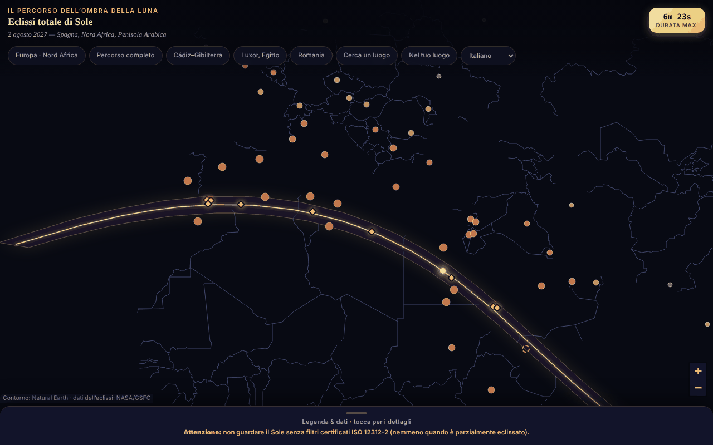

# Eclipsa-2027 — mappa dell'eclissi totale di Sole del 2 agosto 2027

[English](README.md) · [Română](README.ro.md) · [Français](README.fr.md) · **Italiano** · [Español](README.es.md) · [Português](README.pt.md) · [Deutsch](README.de.md) · [Magyar](README.hu.md)

**Versione:** 2.0.0 · **Ultimo aggiornamento:** 2026-10-26

Lingue dell'interfaccia: **Română, English, Français, Italiano, Español, Português (PT), Deutsch, Magyar**

Mappa interattiva, in un unico file HTML, della fascia di totalità (Spagna meridionale, Nord Africa, Penisola Arabica), con durate e copertura parziale per città.

**App online:** https://chiuta.github.io/Eclipsa-2027/

## Che cos'è

Una mappa offline dell'eclissi del 2 agosto 2027 (massimo 6 min 23 s, Saros 136). La fascia e la linea centrale provengono dagli elementi besseliani NASA/GSFC (F. Espenak); il contorno della mappa è Natural Earth, disegnato da dati vettoriali (senza tessere). Se JavaScript manca, viene mostrata una variante statica (SVG + tabelle).

## Funzionalità

- Mappa Leaflet con fascia di totalità, linea centrale e punto di durata massima (26°49′N 31°08′E).
- 59 città con percentuale di copertura parziale e ora del massimo (fuso orario locale); 10 luoghi sul percorso o vicino ad esso con la durata della totalità (approssimativa).
- Pulsanti di salto (Europa, percorso completo, Cadice–Gibilterra, Luxor, Romania), legenda comprimibile.
- «Cerca un luogo»: scrivi il nome di un luogo dell'elenco (senza segni diacritici) o coordinate decimali `lat, lon`; per le coordinate l'applicazione indica, in locale, se il punto è all'interno della fascia di totalità e a quanti km si trova dalla linea centrale / dal bordo più vicino (rispetto al poligono della fascia; indicativo, non calcola la durata della totalità).
- Avviso permanente di sicurezza per gli occhi (ISO 12312-2).
- Interfaccia in 8 lingue (RO, EN, FR, IT, ES, PT, DE, HU): selettore di lingua nella riga dei pulsanti (nei browser con una lingua diversa dal rumeno si apre in inglese; `?lang=ro` o `?lang=en` forza la lingua). La scelta non viene salvata (l'applicazione non usa alcuna memorizzazione); la ricerca accetta anche i nomi inglesi delle città (Lisbon, Warsaw ecc.). La variante statica, senza JavaScript, resta in rumeno.
- I segnaposto delle città si rimpiccioliscono a zoom ridotto, per sovrapporsi meno sugli schermi stretti.

## Nuove funzionalità (1.1.0)

Tutto viene calcolato in locale, con il modulo `FFF.ephem` (effemeridi proprie, senza rete), nella finestra «Nel tuo luogo» (il pulsante nella riga dei pulsanti; compare anche come «Circostanze locali ›» dopo «Cerca un luogo»):

- **Circostanze locali dell'eclissi del 2 agosto 2027** per qualsiasi luogo: contatti C1, C2, massimo, C3, C4 (UTC, e ora locale quando il fuso orario IANA è noto), magnitudine, oscuramento, durata della totalità e della fase parziale, altezza e azimut del Sole, posizione rispetto alla fascia di totalità (dentro/fuori, distanza dal bordo). Il luogo: ricerca per nome (le 59 città, RO/EN), coordinate `lat, lon`, oppure GPS.
- **GPS con consenso esplicito, in due passaggi:** il pulsante «Usa la mia posizione (GPS)» apre prima una conferma nella pagina; solo dopo «Sì» viene effettuata un'unica richiesta `getCurrentPosition`. Le coordinate non vengono salvate né inviate da nessuna parte.
- **Conto alla rovescia** fino al prossimo contatto, con la fase corrente (prima, parziale, totalità — dove conta il tempo rimanente fino a C3 —, dopo) e un pulsante **«Prova»** che avvia un orologio simulato 30 s prima di C2 (o del massimo, per un'eclissi parziale) per esercitarsi.
- **Esportazione `.ics`** (calendario): un evento per l'intera eclissi (C1–C4) e, per la totalità, uno per la totalità (C2–C3), con allarmi `VALARM` facoltativi (un giorno e 15 minuti prima; 5 minuti prima della totalità); orari in UTC, righe ripiegate a 75 ottetti, CRLF.
- **Lista di controllo per l'osservazione in sicurezza** (filtri ISO 12312-2, il momento in cui guardare a occhio nudo è sicuro solo durante la totalità, fotografia, bambini, spostamenti), con avanzamento; le spunte non vengono salvate tra le sessioni.
- **Fascia calcolata sulla mappa:** una casella sovrappone alla mappa Leaflet le linee tratteggiate (limite nord, limite sud, linea centrale) calcolate nell'applicazione, oltre a quelle dei dati NASA incorporati, e mostra lo scarto tra di esse: sul tratto comune, al massimo 3,6 km e in media 0,9 km (misurato il 14.10.2026).
- L'interfaccia ha 8 lingue (RO, EN, FR, IT, ES, PT, DE, HU), scelte dal selettore di lingua; `html[lang]` segue la lingua scelta. Le note lunghe dell'applicazione restano solo in rumeno e inglese (nelle altre lingue si vede l'inglese). Le traduzioni fr/it/es/pt/de/hu sono **automatiche e non verificate da madrelingua**.

## Guida all'uso

1. Apri la pagina; trascina/zooma sulla mappa.
2. Tocca una città per percentuale e ora, o un rombo dorato per la durata della totalità.
3. Usa i pulsanti in alto per zone predefinite o «Cerca un luogo» per una città dell'elenco o per coordinate.
4. Apri «Legenda e dati» (in basso) per legenda, fatti, sicurezza e fonti.

## Privacy e rete

- Non usa localStorage/sessionStorage/IndexedDB, cookie o account.
- Non contatta alcun host esterno (CSP: `connect-src 'none'`); Leaflet è incluso nel file.
- Permessi: nessuno all'avvio; la posizione solo su richiesta esplicita (vedi sotto).

- 1.1.0: la **geolocalizzazione** (`navigator.geolocation`) viene usata solo se premi «Usa la mia posizione (GPS)» e confermi nella pagina; poi anche il browser chiede il permesso. L'esportazione `.ics` e i dati del kit vengono scaricati tramite un `Blob` locale. Non ci sono nuove richieste di rete (CSP `connect-src 'none'` invariata). Il kit `fff-kit` (moduli `core`, `label`, `bundle`, `ephem`) aggiunge il pulsante di trasparenza per versione; l'applicazione non scrive nulla in `localStorage`/`sessionStorage` (verificato all'avvio: 0 chiavi).

## Limiti e avvertenze

- **Sicurezza:** non guardare il Sole senza filtri certificati ISO 12312-2 (né occhiali da sole, né binocolo/cannocchiale senza filtro solare); a occhio nudo solo durante la totalità completa.
- Valori indicativi e approssimativi. Ricalcolati in modo indipendente dagli elementi besseliani NASA (ΔT = 71,7 s): la copertura parziale delle 59 città differisce in media di 0,05 punti percentuali (max. 0,3); le durate della totalità sono per il centro della città e variano di decine di secondi. La cifra «~89 milioni di persone» non è verificata.
- I luoghi al margine della fascia (ad es. Sana'a, ~2–2,5 min) sono sensibili alla posizione esatta; verifica presso fonti ufficiali.
- Progetto personale, non ufficiale.

- **Nuove funzionalità, limiti reali.** I contatti locali sono calcolati per il livello del mare (l'altitudine inserita viene applicata, il rilievo e l'orizzonte locale no); la concordanza con il riferimento indipendente (JPL DE421, separazione topocentrica) è di ≈ 1 s al massimo e ≤ 3 s ai contatti su 10 luoghi di prova, ma ΔT (rotazione della Terra) ha un'incertezza di ≈ ±1 s nel 2027, e il bordo della Luna non è modellato (grani di Baily, bande d'ombra). La durata della totalità al margine della fascia è molto sensibile alla posizione esatta. L'applicazione avvisa quando un contatto avviene sotto l'orizzonte o quando il luogo si trova a meno di 15 km dal bordo.
- **Il conto alla rovescia usa l'orologio del dispositivo**, non una fonte oraria ufficiale: verifica l'ora del telefono. L'applicazione non è uno strumento di sicurezza; i filtri ISO 12312-2 e le istruzioni delle autorità restano obbligatori. Non viene offerto alcun consiglio medico.
- **La fascia calcolata** ha un margine di approssimazione (passo di 5 minuti lungo il percorso, confronto con i dati NASA incorporati); non sostituisce i dati ufficiali.

## Test

`node tests/fff-r8.test.mjs` (Playwright da `/opt/node-tools`, Chromium locale, rete bloccata; `tests/_lib.mjs` contiene le utilità comuni). I valori di riferimento sono in `tests/ref-c3a.json`: circostanze locali per 10 luoghi di riferimento (contatti C1–C4, durata, oscuramento, altezza del Sole; JPL DE421, da `fff-kit/test/ref`), gli istanti di alba/tramonto/transito (Sole, Luna; 5 luoghi × 4 date), 56 istanti di fase e 54 posizioni alt/az, calcolati in modo indipendente con **pyephem 4.2.1** (usato solo offline per generare i numeri; non fa parte dell'applicazione). Ogni test ha la soglia scritta nel codice; il test di accessibilità (axe-core, `bypassCSP`) viene eseguito anche nelle finestre/pannelli aperti, a 1280×800 e 360×740.

## Esecuzione locale / offline

Scarica `index.html` e aprilo in un browser; funziona senza internet.

## Cronologia / Changelog

### 1.3.5 — 2026-10-22

fff-kit 1.1.4: aree tattili e testo minimo. Aree tattili/testo corretti nell’app.

### 1.3.4 — 2026-10-22

fff-kit 1.1.2: PBKDF2 a 600.000 iterazioni, protezione anti-clickjacking.

### 1.3.3 — 2026-10-22
- Accessibilità: esattamente un solo H1 nella pagina (la vista statica senza JavaScript viene rimossa dal DOM una volta avviata la mappa); i marcatori delle città e dei bordi della fascia sulla mappa hanno aree tattili più grandi (24 px).
- Mobile: il testo è di almeno 12 px e pulsanti e campi hanno aree tattili più grandi sugli schermi stretti.

### 1.2.0 — 2026-10-19
- Novità: link «↗ TerRa» dopo il risultato locale — apre TerRa (mappa 2D) al massimo dell'eclissi (locale, o globale se l'eclissi non è visibile), con il luogo scelto come «La mia posizione». Le coordinate (arrotondate a ~1 km) compaiono solo nell'indirizzo della nuova scheda; non vengono inviate da nessuna parte.

### 1.1.0 — 2026-10-14
- Novità: la finestra «Nel tuo luogo» (circostanze locali, conto alla rovescia + prova, esportazione `.ics`, lista di controllo, fascia calcolata sulla mappa, GPS con consenso in due passaggi); ciclo di lingue RO/EN/HU/DE per le nuove funzionalità; `FFF.ephem` e il kit `fff-kit` (`core`, `label`, `bundle`, `ephem`) integrati; `tests/fff-r8.test.mjs` (83 verifiche); schermata aggiornata (il nuovo pulsante). I dati NASA e il resto dell'applicazione non sono stati modificati (confronto prima/dopo a 1280×800: l'unica differenza visibile è il nuovo pulsante).

- 1.0.0 — 2026-10-12: la versione e la data dell'ultimo aggiornamento sono mostrate nell'app
- Turno 7: interfaccia bilingue RO/EN (titoli, legenda, avviso di sicurezza, fonti, finestre sulla mappa e risultati di ricerca); segnaposto scalati secondo lo zoom (mappa più leggibile a 360 px); schermata aggiornata (il pulsante «EN»).
- Aggiunto «Cerca un luogo» (città dell'elenco o coordinate → dentro/fuori dalla fascia e distanze indicative); CSP: `script-src` su hash SHA-256, senza `'unsafe-inline'`; schermata aggiornata (il nuovo pulsante).
- Mappa, intestazione e legenda sono ora punti di riferimento semantici (`main`, `header`, `aside`); axe-core: 0 violazioni a 1280 e 360 px (e anche la variante statica ha il contenuto in `main`).
- L'evento (2 agosto 2027) è ancora futuro a questa data; i dati NASA/GSFC non sono stati modificati.

## Licenza

Licenza: MIT — vedi il file `LICENSE`. Include Leaflet 1.9.4 (BSD-2-Clause, © Vladimir Agafonkin) e dati Natural Earth (pubblico dominio).

## Autore

Alexio — Alexandru-Ionuț Chiuță, contatto: alexio@trom.tf

## Riepilogo
Mappa Leaflet offline, a file singolo, dell'eclissi totale di Sole del 2 agosto 2027: fascia di totalità, linea centrale, punto di durata massima, copertura parziale per 59 città. Dati della fascia dagli elementi besseliani NASA; valori delle città ricontrollati in modo indipendente (scarto medio di 0,05 punti percentuali). Avviso ben visibile sulla sicurezza degli occhi (ISO 12312-2). Nessuna memorizzazione, nessuna richiesta di rete.
