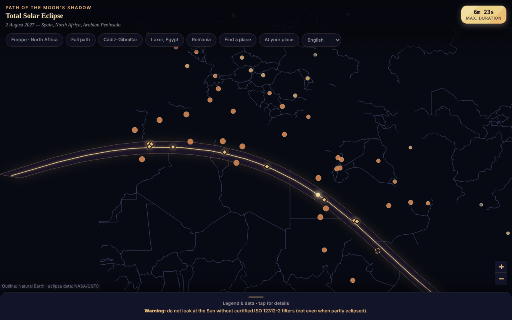

# Eclipsa-2027 — map of the total solar eclipse of 2 August 2027

**English** · [Română](README.ro.md) · [Français](README.fr.md) · [Italiano](README.it.md) · [Español](README.es.md) · [Português](README.pt.md) · [Deutsch](README.de.md) · [Magyar](README.hu.md)

**Version:** 1.3.4 · **Last updated:** 2026-10-22

Interface languages: **Română, English, Français, Italiano, Español, Português (PT), Deutsch, Magyar**

An interactive map, in a single HTML file, of the band of totality (southern Spain, North Africa, the Arabian Peninsula), with durations and partial coverage for cities.

**Live app:** https://chiuta.github.io/Eclipsa-2027/

## What it is

An offline map of the eclipse of 2 August 2027 (maximum 6m 23s, Saros 136). The band and the central line come from the NASA/GSFC Besselian elements (F. Espenak); the map outline is Natural Earth, drawn from vector data (no tiles). If JavaScript is missing, a static variant (SVG + tables) is displayed.

## Features

- Leaflet map with the band of totality, the central line, and the point of greatest duration (26°49′N 31°08′E).
- 59 cities with partial-coverage percentage and time of maximum (local time zone); 10 places on or near the track with the duration of totality (approximate).
- Jump buttons (Europe, full track, Cádiz–Gibraltar, Luxor, Romania), collapsible legend.
- "Search a place": type the name of a place from the list (without diacritics) or decimal coordinates `lat, lon`; for coordinates the application tells you, locally, whether the point lies inside the band of totality and how many km it is from the central line / from the nearest edge (relative to the band polygon; indicative, it does not compute the duration of totality).
- Permanent eye-safety warning (ISO 12312-2).
- Interface in 8 languages (RO, EN, FR, IT, ES, PT, DE, HU): the language selector in the button row (for browsers with a language other than Romanian it opens in English; `?lang=ro` or `?lang=en` forces the language). The choice is not saved (the application uses no storage); the search also accepts English city names (Lisbon, Warsaw, etc.). The static variant, without JavaScript, remains in Romanian.
- City markers shrink at low zoom, so that they overlap less on narrow screens.

## New features (1.1.0)

All are computed locally, with the `FFF.ephem` module (own ephemerides, no network), in the "At your location" dialog (the button in the button row; it also appears as "Local circumstances ›" after "Search a place"):

- **Local circumstances of the 2 August 2027 eclipse** for any place: contacts C1, C2, maximum, C3, C4 (UTC, and local time when the IANA time zone is known), magnitude, obscuration, duration of totality and of the partial phase, altitude and azimuth of the Sun, position relative to the band of totality (inside/outside, distance from the edge). The place: search by name (the 59 cities, RO/EN), coordinates `lat, lon`, or GPS.
- **GPS with explicit consent, in two steps:** the "Use my location (GPS)" button first opens an in-page confirmation; only after "Yes" is a single `getCurrentPosition` request made. The coordinates are not saved and are not sent anywhere.
- **Countdown** to the next contact, with the current phase (before, partial, totality — where it counts down the time remaining until C3 —, after) and a **"Rehearsal"** button that starts a simulated clock 30 s before C2 (or before maximum, for a partial eclipse) so that you can practise.
- **`.ics` export** (calendar): one event for the entire eclipse (C1–C4) and, for totality, one for totality (C2–C3), with optional `VALARM` alarms (one day and 15 minutes before; 5 minutes before totality); times in UTC, lines folded at 75 octets, CRLF.
- **Checklist for safe viewing** (ISO 12312-2 filters, the moment when looking with the naked eye is safe only during totality, photography, children, travel), with progress; the ticks are not saved between sessions.
- **Computed band on the map:** a tick overlays on the Leaflet map the dotted lines (northern limit, southern limit, central line) computed in the application, in addition to those from the embedded NASA data, and shows the deviation between them: over the common stretch, a maximum of 3.6 km and on average 0.9 km (measured on 14.10.2026).
- The interface has 8 languages (RO, EN, FR, IT, ES, PT, DE, HU), chosen from the language selector; `html[lang]` follows the chosen language. The application's long notes remain only in Romanian and English (in the other languages English is shown). The fr/it/es/pt/de/hu translations are **automatic and not verified by native speakers**.

## User guide

1. Open the page; drag/zoom on the map.
2. Tap a city for percentage and time, or a golden diamond for the duration of totality.
3. Use the buttons at the top for predefined areas or "Search a place" for a city from the list or for coordinates.
4. Open "Legend & data" (bottom) for the legend, facts, safety and sources.

## Privacy and network

- It uses no localStorage/sessionStorage/IndexedDB, cookies or accounts.
- It contacts no external host (CSP: `connect-src 'none'`); Leaflet is included in the file.
- Permissions: none at startup; location only on explicit request (see below).

- 1.1.0: **geolocation** (`navigator.geolocation`) is used only if you press "Use my location (GPS)" and confirm in the page; the browser then asks for permission as well. The `.ics` export and the kit's data are downloaded via a local `Blob`. There are no new network requests (CSP `connect-src 'none'` unchanged). The `fff-kit` kit (modules `core`, `label`, `bundle`, `ephem`) adds the per-version transparency button; the application writes nothing to `localStorage`/`sessionStorage` (checked at startup: 0 keys).

## Limits and warnings

- **Safety:** do not look at the Sun without certified ISO 12312-2 filters (not sunglasses, not binoculars/telescope without a solar filter); naked eye only during full totality.
- Informational and approximate values. Independently recomputed from the NASA Besselian elements (ΔT = 71.7 s): the partial coverage of the 59 cities differs on average by 0.05 percentage points (max. 0.3); the durations of totality are for the city centre and vary by tens of seconds. The figure "~89 million people" is unverified.
- Places at the edge of the band (e.g. Sana'a, ~2–2.5 min) are sensitive to the exact location; check official sources.
- Personal, unofficial project.

- **New features, real limits.** The local contacts are computed for sea level (the altitude entered is applied, the relief and the local horizon are not); agreement with the independent reference (JPL DE421, topocentric separation) is ≈ 1 s at maximum and ≤ 3 s at contacts over 10 test locations, but ΔT (Earth's rotation) has an uncertainty of ≈ ±1 s in 2027, and the Moon's limb is not modelled (Baily's beads, shadow bands). The duration of totality at the edge of the band is very sensitive to the exact location. The application warns when a contact occurs below the horizon or when the place is less than 15 km from the edge.
- **The countdown uses the device clock**, not an official time source: check your phone's time. The application is not a safety instrument; ISO 12312-2 filters and the authorities' instructions remain mandatory. No medical advice is given.
- **The computed band** has an approximation margin (5-minute step along the track, comparison with the embedded NASA data); it does not replace official data.

## Tests

`node tests/fff-r8.test.mjs` (Playwright from `/opt/node-tools`, local Chromium, network blocked; `tests/_lib.mjs` has the shared helpers). The reference values are in `tests/ref-c3a.json`: local circumstances for 10 reference locations (contacts C1–C4, duration, obscuration, Sun altitude; JPL DE421, from `fff-kit/test/ref`), the sunrise/sunset/transit times (Sun, Moon; 5 locations × 4 dates), 56 phase moments and 54 alt/az positions, computed independently with **pyephem 4.2.1** (used only offline to generate the numbers; it is not part of the application). Each test has its threshold written in the code; the accessibility test (axe-core, `bypassCSP`) also runs in open dialogs/panels, at 1280×800 and 360×740.

## Running locally / offline

Download `index.html` and open it in a browser; it works without internet.

## History / Changelog

### 1.3.4 — 2026-10-22

fff-kit 1.1.2: PBKDF2 with 600,000 iterations, anti-clickjacking protection.

### 1.3.3 — 2026-10-22
- Accessibility: exactly one H1 in the page (the static no-JavaScript view is removed from the DOM once the map is running); the city and edge markers on the map have larger touch targets (24 px).
- Mobile: text is at least 12 px and buttons and fields have larger touch targets on narrow screens.

### 1.2.0 — 2026-10-19
- New: "↗ TerRa" link after the local result — opens TerRa (2D map) at the eclipse maximum (local, or global if the eclipse is not visible), with the chosen place as "My location". The coordinates (rounded to ~1 km) appear only in the address of the new tab; they are not sent anywhere.

### 1.1.0 — 2026-10-14
- New: the "At your location" dialog (local circumstances, countdown + rehearsal, `.ics` export, checklist, computed band on the map, GPS with two-step consent); RO/EN/HU/DE language cycle for the new features; `FFF.ephem` and the `fff-kit` kit (`core`, `label`, `bundle`, `ephem`) integrated; `tests/fff-r8.test.mjs` (83 checks); screenshot updated (the new button). The NASA data and the rest of the application were not modified (before/after comparison at 1280×800: the only visible difference is the new button).

- 1.0.0 — 2026-10-12: the version and the last-updated date are shown in the app
- Round 7: bilingual RO/EN interface (titles, legend, safety warning, sources, map windows and search results); markers scaled by zoom (more legible map at 360 px); screenshot updated (the "EN" button).
- Added "Search a place" (city from the list or coordinates → inside/outside the band and indicative distances); CSP: `script-src` on a SHA-256 hash, without `'unsafe-inline'`; screenshot updated (the new button).
- Map, header and legend are now semantic landmarks (`main`, `header`, `aside`); axe-core: 0 violations at 1280 and 360 px (and the static variant also has its content in `main`).
- The event (2 August 2027) is still in the future at this date; the NASA/GSFC data were not modified.

## License

License: MIT — see the `LICENSE` file. Includes Leaflet 1.9.4 (BSD-2-Clause, © Vladimir Agafonkin) and Natural Earth data (public domain).

## Author

Alexio — Alexandru-Ionuț Chiuță, contact: alexio@trom.tf

## English summary

Offline single-file Leaflet map of the 2 August 2027 total solar eclipse: totality band, central line, greatest-duration point, partial coverage for 59 cities. Band data from NASA Besselian elements; city values independently re-checked (mean deviation 0.05 percentage points). Prominent eye-safety warning (ISO 12312-2). No storage, no network requests.
