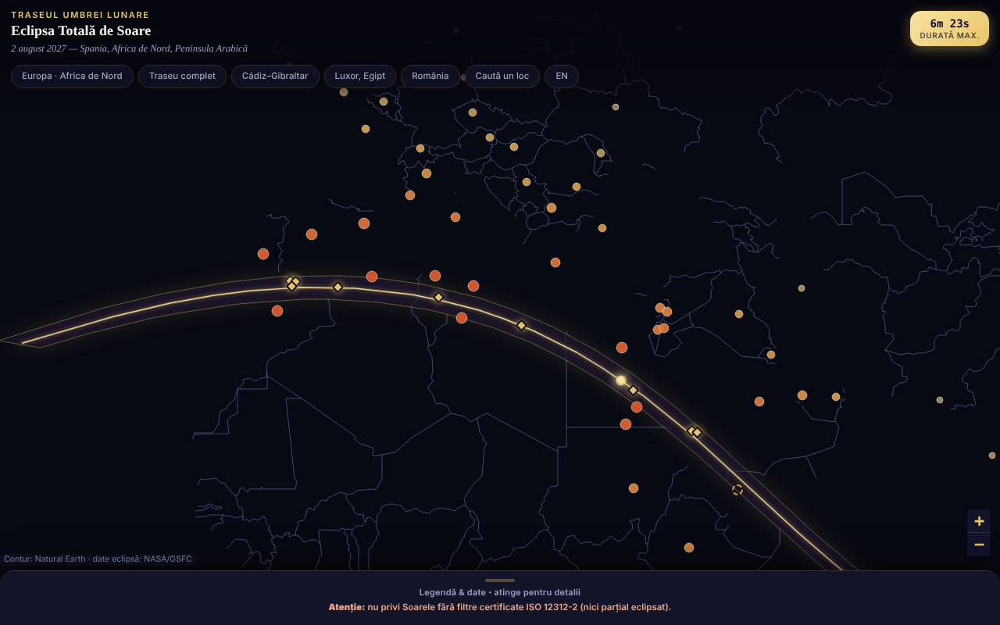

# Eclipsa-2027 — harta eclipsei totale de Soare din 2 august 2027

Hartă interactivă, într-un singur fișier HTML, a benzii de totalitate (Spania de sud, Africa de Nord, Peninsula Arabică), cu durate și acoperirea parțială pe orașe.

**Live:** https://chiuta.github.io/Eclipsa-2027/

## Ce este

O hartă offline a eclipsei din 2 august 2027 (maxim 6m 23s, Saros 136). Banda și linia centrală provin din elementele Besselian NASA/GSFC (F. Espenak); conturul hărții este Natural Earth, desenat din date vectoriale (fără tile-uri). Dacă JavaScript lipsește, se afișează o variantă statică (SVG + tabele).

## Funcții

- Hartă Leaflet cu bandă de totalitate, linie centrală, punctul de durată maximă (26°49′N 31°08′E).
- 59 de orașe cu procent de acoperire parțială și ora maximului (fus local); 10 locuri pe/lângă traseu cu durata totalității (aproximativă).
- Butoane de salt (Europa, traseu complet, Cádiz–Gibraltar, Luxor, România), legendă pliabilă.
- „Caută un loc”: scrii numele unui loc din listă (fără diacritice) sau coordonate zecimale `lat, lon`; pentru coordonate aplicația spune, local, dacă punctul e în interiorul benzii de totalitate și la câți km este de linia centrală / de cea mai apropiată margine (față de poligonul benzii; orientativ, nu calculează durata totalității).
- Avertisment permanent de siguranță a ochilor (ISO 12312-2).
- Interfață în română și engleză: butonul „EN”/„RO” din rândul de butoane (la browsere cu altă limbă decât româna se deschide în engleză; `?lang=ro` sau `?lang=en` forțează limba). Alegerea nu se salvează (aplicația nu folosește stocare); căutarea acceptă și numele englezești ale orașelor (Lisbon, Warsaw etc.). Varianta statică, fără JavaScript, rămâne în română.
- Marcajele orașelor se micșorează la zoom mic, ca să se suprapună mai puțin pe ecrane înguste.

## Manual de utilizare

1. Deschide pagina; trage/zoom pe hartă.
2. Atinge un oraș pentru procent și oră, sau un romb auriu pentru durata totalității.
3. Folosește butoanele de sus pentru zone predefinite sau „Caută un loc” pentru un oraș din listă ori pentru coordonate.
4. Deschide „Legendă & date” (jos) pentru legendă, fapte, siguranță și surse.

## Confidențialitate și rețea

- Nu folosește localStorage/sessionStorage/IndexedDB, cookie-uri sau conturi.
- Nu contactează nicio gazdă externă (CSP: `connect-src 'none'`); Leaflet este inclus în fișier.
- Nu cere permisiuni ale browserului.

## Limite și avertismente

- **Siguranță:** nu privi Soarele fără filtre certificate ISO 12312-2 (nu ochelari de soare, nu binoclu/lunetă fără filtru solar); ochiul liber doar în totalitate completă.
- Valori informative și aproximative. Recalculate independent din elementele Besselian NASA (ΔT = 71,7 s): acoperirea parțială a celor 59 de orașe diferă în medie cu 0,05 puncte procentuale (max. 0,3); duratele de totalitate sunt pentru centrul orașului și variază cu zeci de secunde. Cifra „~89 mil. oameni” este neverificată.
- Locuri la marginea benzii (ex. Sana'a, ~2–2,5 min) sunt sensibile la locul exact; verifică la surse oficiale.
- Proiect personal, neoficial.

## Rulare locală / offline

Descarcă `index.html` și deschide-l în browser; funcționează fără internet.

## Istoric / Changelog

Ultima actualizare: 11 octombrie 2026.

- Runda 7: interfață bilingvă RO/EN (titluri, legendă, avertisment de siguranță, surse, ferestrele de pe hartă și rezultatele căutării); marcaje scalate după zoom (hartă mai lizibilă pe 360 px); captură de ecran actualizată (butonul „EN”).
- Adăugat „Caută un loc” (oraș din listă sau coordonate → în/în afara benzii și distanțe orientative); CSP: `script-src` pe hash SHA-256, fără `'unsafe-inline'`; captură de ecran actualizată (butonul nou).
- Hartă, antet și legendă sunt acum repere semantice (`main`, `header`, `aside`); axe-core: 0 violări la 1280 și 360 px (și varianta statică are conținutul în `main`).
- Evenimentul (2 august 2027) este încă viitor la această dată; datele NASA/GSFC nu au fost modificate.

## Licență

Licența nu este încă declarată. Include Leaflet 1.9.4 (BSD-2-Clause, © Vladimir Agafonkin) și date Natural Earth (domeniu public).

## Autor

Alexio — Alexandru-Ionuț Chiuță, contact: alexio@trom.tf

## English summary

Offline single-file Leaflet map of the 2 August 2027 total solar eclipse: totality band, central line, greatest-duration point, partial coverage for 59 cities. Band data from NASA Besselian elements; city values independently re-checked (mean deviation 0.05 percentage points). Prominent eye-safety warning (ISO 12312-2). No storage, no network requests.
