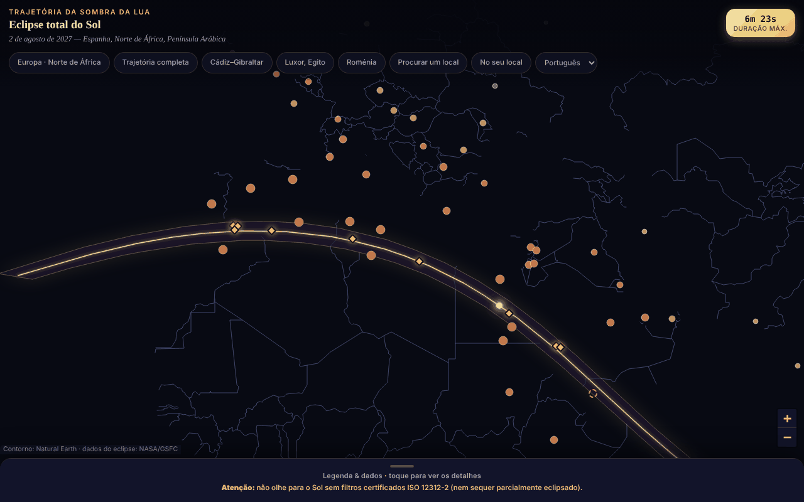

# Eclipsa-2027 — mapa do eclipse total do Sol de 2 de agosto de 2027

[English](README.md) · [Română](README.ro.md) · [Français](README.fr.md) · [Italiano](README.it.md) · [Español](README.es.md) · **Português** · [Deutsch](README.de.md) · [Magyar](README.hu.md)

**Versão:** 2.2.1 · **Última atualização:** 2026-10-31

Idiomas da interface: **Română, English, Français, Italiano, Español, Português (PT), Deutsch, Magyar**

Mapa interativo, num único ficheiro HTML, da faixa de totalidade (sul de Espanha, Norte de África, Península Arábica), com durações e cobertura parcial por cidades.

**Aplicação online:** https://chiuta.github.io/Eclipsa-2027/

## O que é

Um mapa offline do eclipse de 2 de agosto de 2027 (máximo 6 min 23 s, Saros 136). A faixa e a linha central provêm dos elementos besselianos da NASA/GSFC (F. Espenak); o contorno do mapa é Natural Earth, desenhado a partir de dados vetoriais (sem mosaicos). Se o JavaScript não estiver disponível, é apresentada uma variante estática (SVG + tabelas).

## Funcionalidades

- Mapa Leaflet com faixa de totalidade, linha central e ponto de duração máxima (26°49′N 31°08′E).
- 59 cidades com percentagem de cobertura parcial e hora do máximo (fuso horário local); 10 locais sobre o percurso ou próximo dele com a duração da totalidade (aproximada).
- Botões de salto (Europa, percurso completo, Cádis–Gibraltar, Luxor, Roménia), legenda recolhível.
- «Procurar um local»: escreva o nome de um local da lista (sem sinais diacríticos) ou coordenadas decimais `lat, lon`; para coordenadas, a aplicação indica, localmente, se o ponto está dentro da faixa de totalidade e a quantos km se encontra da linha central / do limite mais próximo (relativamente ao polígono da faixa; indicativo, não calcula a duração da totalidade).
- Aviso permanente de segurança ocular (ISO 12312-2).
- Interface em 8 idiomas (RO, EN, FR, IT, ES, PT, DE, HU): seletor de idioma na linha de botões (em navegadores com uma língua diferente do romeno abre em inglês; `?lang=ro` ou `?lang=en` força a língua). A escolha não é guardada (a aplicação não usa armazenamento); a pesquisa aceita também os nomes ingleses das cidades (Lisbon, Warsaw, etc.). A variante estática, sem JavaScript, permanece em romeno.
- Os marcadores das cidades diminuem com pouco zoom, para se sobreporem menos em ecrãs estreitos.

## Novas funcionalidades (1.1.0)

Tudo é calculado localmente, com o módulo `FFF.ephem` (efemérides próprias, sem rede), na caixa «No seu local» (o botão da linha de botões; surge também como «Circunstâncias locais ›» depois de «Procurar um local»):

- **Circunstâncias locais do eclipse de 2 de agosto de 2027** para qualquer local: contactos C1, C2, máximo, C3, C4 (UTC, e hora local quando o fuso horário IANA é conhecido), magnitude, obscurecimento, duração da totalidade e da fase parcial, altura e azimute do Sol, posição relativamente à faixa de totalidade (dentro/fora, distância ao limite). O local: pesquisa por nome (as 59 cidades, RO/EN), coordenadas `lat, lon` ou GPS.
- **GPS com consentimento explícito, em dois passos:** o botão «Usar a minha localização (GPS)» abre primeiro uma confirmação na página; só depois de «Sim» é feito um único pedido `getCurrentPosition`. As coordenadas não são guardadas nem enviadas para lado nenhum.
- **Contagem decrescente** até ao próximo contacto, com a fase atual (antes, parcial, totalidade — em que conta o tempo restante até C3 —, depois) e um botão **«Ensaio»** que inicia um relógio simulado 30 s antes de C2 (ou do máximo, num eclipse parcial) para praticar.
- **Exportação `.ics`** (calendário): um evento para todo o eclipse (C1–C4) e, em caso de totalidade, um para a totalidade (C2–C3), com alarmes `VALARM` opcionais (um dia e 15 minutos antes; 5 minutos antes da totalidade); horas em UTC, linhas dobradas aos 75 octetos, CRLF.
- **Lista de verificação para a observação em segurança** (filtros ISO 12312-2, o momento em que olhar a olho nu é seguro apenas durante a totalidade, fotografia, crianças, deslocação), com progresso; as marcações não são guardadas entre sessões.
- **Faixa calculada no mapa:** uma caixa sobrepõe ao mapa Leaflet as linhas a tracejado (limite norte, limite sul, linha central) calculadas na aplicação, além das dos dados NASA incorporados, e mostra o desvio entre elas: no troço comum, no máximo 3,6 km e em média 0,9 km (medido em 14.10.2026).
- A interface tem 8 línguas (RO, EN, FR, IT, ES, PT, DE, HU), escolhidas no seletor de língua; `html[lang]` segue a língua escolhida. As notas longas da aplicação permanecem apenas em romeno e inglês (nas outras línguas vê-se o inglês). As traduções fr/it/es/pt/de/hu são **automáticas e não verificadas por falantes nativos**.

## Manual de utilização

1. Abra a página; arraste/amplie no mapa.
2. Toque numa cidade para ver a percentagem e a hora, ou num losango dourado para a duração da totalidade.
3. Use os botões de cima para zonas predefinidas ou «Procurar um local» para uma cidade da lista ou para coordenadas.
4. Abra «Legenda e dados» (em baixo) para a legenda, factos, segurança e fontes.

## Privacidade e rede

- Não usa localStorage/sessionStorage/IndexedDB, cookies nem contas.
- Não contacta nenhum anfitrião externo (CSP: `connect-src 'none'`); o Leaflet está incluído no ficheiro.
- Permissões: nenhuma no arranque; a localização apenas mediante pedido explícito (veja abaixo).

- 1.1.0: a **geolocalização** (`navigator.geolocation`) só é usada se premir «Usar a minha localização (GPS)» e confirmar na página; depois o navegador pede também a permissão. A exportação `.ics` e os dados do kit são transferidos através de um `Blob` local. Não há novos pedidos de rede (CSP `connect-src 'none'` inalterada). O kit `fff-kit` (módulos `core`, `label`, `bundle`, `ephem`) acrescenta o botão de transparência por versão; a aplicação não escreve nada em `localStorage`/`sessionStorage` (verificado no arranque: 0 chaves).

## Limites e avisos

- **Segurança:** não olhe para o Sol sem filtros certificados ISO 12312-2 (nem óculos de sol, nem binóculos/luneta sem filtro solar); a olho nu apenas durante a totalidade completa.
- Valores informativos e aproximados. Recalculados de forma independente a partir dos elementos besselianos da NASA (ΔT = 71,7 s): a cobertura parcial das 59 cidades difere em média 0,05 pontos percentuais (máx. 0,3); as durações da totalidade são para o centro da cidade e variam em dezenas de segundos. O número «~89 milhões de pessoas» não está verificado.
- Os locais no limite da faixa (p. ex. Sana, ~2–2,5 min) são sensíveis à localização exata; verifique em fontes oficiais.
- Projeto pessoal, não oficial.

- **Novas funcionalidades, limites reais.** Os contactos locais são calculados para o nível do mar (a altitude introduzida é aplicada, o relevo e o horizonte local não); a concordância com a referência independente (JPL DE421, separação topocêntrica) é de ≈ 1 s no máximo e ≤ 3 s nos contactos em 10 locais de teste, mas ΔT (rotação da Terra) tem uma incerteza de ≈ ±1 s em 2027, e o bordo da Lua não está modelado (contas de Baily, bandas de sombra). A duração da totalidade no limite da faixa é muito sensível à localização exata. A aplicação avisa quando um contacto ocorre abaixo do horizonte ou quando o local está a menos de 15 km do limite.
- **A contagem decrescente usa o relógio do dispositivo**, não uma fonte horária oficial: verifique a hora do telemóvel. A aplicação não é um instrumento de segurança; os filtros ISO 12312-2 e as instruções das autoridades continuam a ser obrigatórios. Não é prestado aconselhamento médico.
- **A faixa calculada** tem uma margem de aproximação (passo de 5 minutos ao longo do percurso, comparação com os dados NASA incorporados); não substitui os dados oficiais.

## Testes

`node tests/fff-r8.test.mjs` (Playwright a partir de `/opt/node-tools`, Chromium local, rede bloqueada; `tests/_lib.mjs` contém os utilitários comuns). Os valores de referência estão em `tests/ref-c3a.json`: circunstâncias locais para 10 locais de referência (contactos C1–C4, duração, obscurecimento, altura do Sol; JPL DE421, de `fff-kit/test/ref`), os instantes de nascer/pôr/passagem meridiana (Sol, Lua; 5 locais × 4 datas), 56 instantes de fase e 54 posições alt/az, calculados de forma independente com **pyephem 4.2.1** (usado apenas offline para gerar os números; não faz parte da aplicação). Cada teste tem o seu limiar escrito no código; o teste de acessibilidade (axe-core, `bypassCSP`) corre também em diálogos/painéis abertos, a 1280×800 e 360×740.

## Execução local / offline

Transfira `index.html` e abra-o num navegador; funciona sem internet.

## Histórico / Changelog

### 1.3.5 — 2026-10-22

fff-kit 1.1.4: áreas de toque e texto mínimo. Áreas de toque/texto corrigidos na aplicação.

### 1.3.4 — 2026-10-22

fff-kit 1.1.2: PBKDF2 com 600.000 iterações, proteção anti-clickjacking.

### 1.3.3 — 2026-10-22
- Acessibilidade: exatamente um só H1 na página (a vista estática sem JavaScript é removida do DOM depois de o mapa arrancar); os marcadores das cidades e dos bordos da faixa no mapa têm áreas táteis maiores (24 px).
- Móvel: o texto tem pelo menos 12 px e os botões e campos têm áreas táteis maiores em ecrãs estreitos.

### 1.2.0 — 2026-10-19
- Novo: ligação «↗ TerRa» depois do resultado local — abre o TerRa (mapa 2D) no máximo do eclipse (local, ou global se o eclipse não for visível), com o local escolhido como «A minha localização». As coordenadas (arredondadas a ~1 km) aparecem apenas no endereço do novo separador; não são enviadas para lado nenhum.

### 1.1.0 — 2026-10-14
- Novo: a caixa «No seu local» (circunstâncias locais, contagem decrescente + ensaio, exportação `.ics`, lista de verificação, faixa calculada no mapa, GPS com consentimento em dois passos); ciclo de línguas RO/EN/HU/DE para as novas funcionalidades; `FFF.ephem` e o kit `fff-kit` (`core`, `label`, `bundle`, `ephem`) integrados; `tests/fff-r8.test.mjs` (83 verificações); captura de ecrã atualizada (o botão novo). Os dados NASA e o resto da aplicação não foram modificados (comparação antes/depois a 1280×800: a única diferença visível é o botão novo).

- 1.0.0 — 2026-10-12: a versão e a data da última atualização são apresentadas na aplicação
- Ronda 7: interface bilingue RO/EN (títulos, legenda, aviso de segurança, fontes, janelas do mapa e resultados da pesquisa); marcadores escalados conforme o zoom (mapa mais legível a 360 px); captura de ecrã atualizada (o botão «EN»).
- Acrescentado «Procurar um local» (cidade da lista ou coordenadas → dentro/fora da faixa e distâncias indicativas); CSP: `script-src` com hash SHA-256, sem `'unsafe-inline'`; captura de ecrã atualizada (o botão novo).
- O mapa, o cabeçalho e a legenda são agora pontos de referência semânticos (`main`, `header`, `aside`); axe-core: 0 violações a 1280 e 360 px (e a variante estática também tem o conteúdo em `main`).
- O evento (2 de agosto de 2027) ainda é futuro a esta data; os dados NASA/GSFC não foram modificados.

## Licença

Licença: MIT — veja o ficheiro `LICENSE`. Inclui o Leaflet 1.9.4 (BSD-2-Clause, © Vladimir Agafonkin) e dados Natural Earth (domínio público).

## Autor

Alexio — Alexandru-Ionuț Chiuță, contacto: alexio@trom.tf

## Resumo
Mapa Leaflet offline, num único ficheiro, do eclipse total do Sol de 2 de agosto de 2027: faixa de totalidade, linha central, ponto de duração máxima, cobertura parcial para 59 cidades. Dados da faixa a partir dos elementos besselianos da NASA; valores das cidades reverificados de forma independente (desvio médio de 0,05 pontos percentuais). Aviso destacado sobre segurança ocular (ISO 12312-2). Sem armazenamento, sem pedidos de rede.
