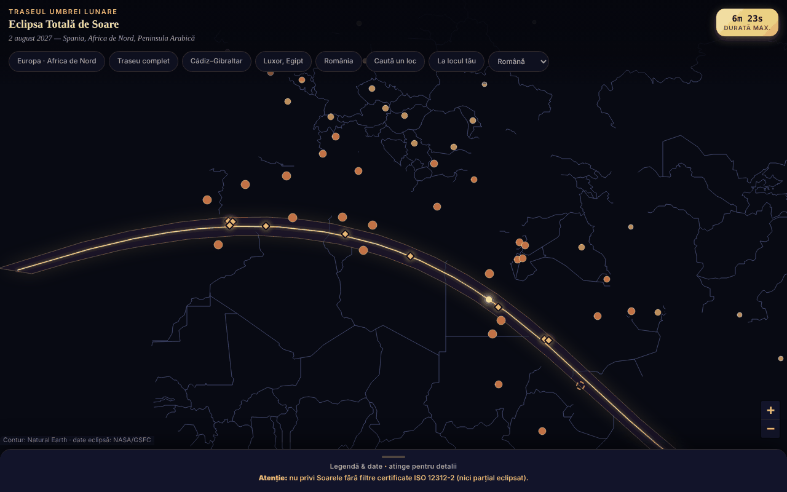

# Eclipsa-2027 — harta eclipsei totale de Soare din 2 august 2027

[English](README.md) · **Română** · [Français](README.fr.md) · [Italiano](README.it.md) · [Español](README.es.md) · [Português](README.pt.md) · [Deutsch](README.de.md) · [Magyar](README.hu.md)

**Versiune:** 2.2.0 (anterior: v2.1.0) · **Ultima actualizare:** 2026-10-27

**Stare:** stabil · **Offline:** complet (harta, calculele, animația și alarma nu cer rețea; legătura către Bolta cere internet doar la clic)

Limbile interfeței: **Română, English, Français, Italiano, Español, Português (PT), Deutsch, Magyar**

Hartă interactivă, într-un singur fișier HTML, a benzii de totalitate (Spania de sud, Africa de Nord, Peninsula Arabică), cu durate și acoperirea parțială pe orașe.

**Live:** https://chiuta.github.io/Eclipsa-2027/

**Nou în 2.2.0:** butonul **„Umbra pe hartă”** rulează un film de 30 s (≈ 3 h 23 min reale) cu umbra totală a Lunii care traversează harta Leaflet: centrul și un contur de 72 de puncte, calculate în aplicație din elementele Besselian pe elipsoidul WGS84 (fără relief; fără penumbră). Pornește doar la clic, cu pauză/redare, cursor (tastatură) pentru ora UTC și buton de închidere; limitele sunt scrise în pagină. Testat față de linia centrală a kitului (≤ 1 km) și lățimea benzii.

**Nou în 2.1.0:** (1) buton de **animație** în *Cerul din locul tău*: Luna traversează Soarele de la C1 la C4 în 30 s (pornește doar la cererea ta; pauză, sau mută cursorul / sari la un contact ca să o oprești); (2) **alarmă sonoră și cu vibrație la contactele C1–C4** (opțională, plus avertisment cu 10 s înainte de sfârșitul totalității), calculată din ceasul dispozitivului și care funcționează **doar cât timp pagina e deschisă, în prim-plan și cu ecranul pornit** (nu folosește notificări, nu cere permisiuni; nu înlocuiește alarmele din calendar `.ics` și nu e un instrument de siguranță; are buton de test și merge cu *Repetiția*); (3) **legătură reciprocă cu Bolta**, planetariul offline (aplicații separate, nu unificate: Eclipsa-2027 arată banda și circumstanțele acestei eclipse, Bolta arată cerul în orice loc și moment; legătura se deschide doar la clic și cere internet). Textele noilor funcții există în română și engleză; celelalte limbi afișează engleza (neverificat nativ).

**Nou în 2.0.0:** *Cerul din locul tău* — un cursor între C1 și C4 arată Luna acoperind Soarele (acoperire, magnitudine, altitudinea și azimutul Soarelui), cu salt direct la fiecare contact; plus un *ghid de fotografiere orientativ*: dimensiunea imaginii Soarelui pe senzor pentru distanța focală aleasă și expuneri echivalente (ISO, diafragmă, bracketing ±3 EV) calculate dintr-o probă făcută de tine pe Soarele filtrat. Sunt calcule, nu valori garantate: nu se inventează nicio expunere de referință, iar regulile de siguranță rămân neschimbate.

## Ce este

O hartă offline a eclipsei din 2 august 2027 (maxim 6m 23s, Saros 136). Banda și linia centrală provin din elementele Besselian NASA/GSFC (F. Espenak); conturul hărții este Natural Earth, desenat din date vectoriale (fără tile-uri). Dacă JavaScript lipsește, se afișează o variantă statică (SVG + tabele).

## Funcții

- Hartă Leaflet cu bandă de totalitate, linie centrală, punctul de durată maximă (26°49′N 31°08′E).
- 59 de orașe cu procent de acoperire parțială și ora maximului (fus local); 10 locuri pe/lângă traseu cu durata totalității (aproximativă).
- Butoane de salt (Europa, traseu complet, Cádiz–Gibraltar, Luxor, România), legendă pliabilă.
- „Caută un loc”: scrii numele unui loc din listă (fără diacritice) sau coordonate zecimale `lat, lon`; pentru coordonate aplicația spune, local, dacă punctul e în interiorul benzii de totalitate și la câți km este de linia centrală / de cea mai apropiată margine (față de poligonul benzii; orientativ, nu calculează durata totalității).
- Avertisment permanent de siguranță a ochilor (ISO 12312-2).
- Interfață în 8 limbi (RO, EN, FR, IT, ES, PT, DE, HU): selectorul de limbă din rândul de butoane (la browsere cu altă limbă decât româna se deschide în engleză; `?lang=ro` sau `?lang=en` forțează limba). Alegerea nu se salvează (aplicația nu folosește stocare); căutarea acceptă și numele englezești ale orașelor (Lisbon, Warsaw etc.). Varianta statică, fără JavaScript, rămâne în română.
- Marcajele orașelor se micșorează la zoom mic, ca să se suprapună mai puțin pe ecrane înguste.

## Funcții noi (1.1.0)

Toate se calculează local, cu modulul `FFF.ephem` (efemeride proprii, fără rețea), în dialogul „La locul tău” (butonul din rândul de butoane; apare și ca „Circumstanțe locale ›” după „Caută un loc”):

- **Circumstanțe locale ale eclipsei din 2 august 2027** pentru orice loc: contactele C1, C2, maxim, C3, C4 (UTC, iar ora locală când fusul orar IANA e cunoscut), magnitudinea, obscurarea, durata totalității și a fazei parțiale, altitudinea și azimutul Soarelui, poziția față de banda totalității (în/în afara, distanța de margine). Locul: căutare după nume (cele 59 de orașe, RO/EN), coordonate `lat, lon`, sau GPS.
- **GPS cu consimțământ explicit, în două trepte:** butonul „Folosește locația mea (GPS)” deschide întâi o confirmare în pagină; abia după „Da” se face o singură cerere `getCurrentPosition`. Coordonatele nu se salvează și nu se trimit nicăieri.
- **Numărătoare inversă** până la următorul contact, cu faza curentă (înainte, parțial, totalitate — unde numără timpul rămas până la C3 —, după) și buton **„Repetiție”** care pornește un ceas simulat cu 30 s înainte de C2 (sau de maxim, la eclipsă parțială) ca să exersezi.
- **Export `.ics`** (calendar): un eveniment pentru întreaga eclipsă (C1–C4) și, la totalitate, unul pentru totalitate (C2–C3), cu alarme `VALARM` opționale (cu o zi și cu 15 minute înainte; 5 minute înainte de totalitate); ore în UTC, linii pliate la 75 de octeți, CRLF.
- **Listă de verificare pentru observarea în siguranță** (filtre ISO 12312-2, momentul în care e sigur privitul cu ochiul liber doar în totalitate, fotografiere, copii, deplasare), cu progres; bifele nu se salvează între sesiuni.
- **Banda calculată pe hartă:** o bifă suprapune pe harta Leaflet liniile punctate (limita nordică, cea sudică, linia centrală) calculate în aplicație, pe lângă cele din datele NASA încorporate, și afișează abaterea dintre ele: pe porțiunea comună, maximum 3,6 km și în medie 0,9 km (măsurat la 14.10.2026).
- Interfața are 8 limbi (RO, EN, FR, IT, ES, PT, DE, HU), alese din selectorul de limbă; `html[lang]` urmează limba aleasă. Notele lungi ale aplicației rămân doar în română și engleză (în celelalte limbi se vede engleza). Traducerile fr/it/es/pt/de/hu sunt **automate și neverificate nativ**.

## Manual de utilizare

1. Deschide pagina; trage/zoom pe hartă.
2. Atinge un oraș pentru procent și oră, sau un romb auriu pentru durata totalității.
3. Folosește butoanele de sus pentru zone predefinite sau „Caută un loc” pentru un oraș din listă ori pentru coordonate.
4. Deschide „Legendă & date” (jos) pentru legendă, fapte, siguranță și surse.

## Confidențialitate și rețea

- Nu folosește localStorage/sessionStorage/IndexedDB, cookie-uri sau conturi.
- Nu contactează nicio gazdă externă (CSP: `connect-src 'none'`); Leaflet este inclus în fișier.
- Permisiuni: niciuna la pornire; locația doar la cerere explicită (vezi mai jos).

- 1.1.0: **geolocația** (`navigator.geolocation`) se folosește doar dacă apeși „Folosește locația mea (GPS)” și confirmi în pagină; apoi browserul cere și el permisiunea. Exportul `.ics` și datele din kit se descarcă prin `Blob` local. Nu există cereri de rețea noi (CSP `connect-src 'none'` neschimbat). Kitul `fff-kit` (module `core`, `label`, `bundle`, `ephem`) adaugă butonul de transparență pe versiune; aplicația nu scrie nimic în `localStorage`/`sessionStorage` (verificat la pornire: 0 chei).
## Limite și avertismente

- **Siguranță:** nu privi Soarele fără filtre certificate ISO 12312-2 (nu ochelari de soare, nu binoclu/lunetă fără filtru solar); ochiul liber doar în totalitate completă.
- Valori informative și aproximative. Recalculate independent din elementele Besselian NASA (ΔT = 71,7 s): acoperirea parțială a celor 59 de orașe diferă în medie cu 0,05 puncte procentuale (max. 0,3); duratele de totalitate sunt pentru centrul orașului și variază cu zeci de secunde. Cifra „~89 mil. oameni” este neverificată.
- Locuri la marginea benzii (ex. Sana'a, ~2–2,5 min) sunt sensibile la locul exact; verifică la surse oficiale.
- Proiect personal, neoficial.

- **Funcții noi, limite reale.** Contactele locale sunt calculate pentru nivelul mării (altitudinea introdusă se aplică, relieful și orizontul local nu); concordanța cu referința independentă (JPL DE421, separare topocentrică) este de ≈ 1 s la maxim și ≤ 3 s la contacte pe 10 locuri de test, dar ΔT (rotația Pământului) are o incertitudine de ≈ ±1 s în 2027, iar marginea Lunii nu e modelată (perlele lui Baily, valuri de umbră). Durata totalității la marginea benzii e foarte sensibilă la locul exact. Aplicația avertizează când un contact are loc sub orizont sau când locul e la mai puțin de 15 km de margine.
- **Numărătoarea folosește ceasul dispozitivului**, nu o sursă de timp oficială: verifică ora telefonului. Aplicația nu este un instrument de siguranță; filtrele ISO 12312-2 și instrucțiunile autorităților rămân obligatorii. Nu se oferă sfat medical.
- **Banda calculată** are fir de aproximare (pas de 5 minute pe traseu, comparație cu datele NASA încorporate); nu înlocuiește datele oficiale.
## Teste

`node tests/fff-r8.test.mjs` (Playwright din `/opt/node-tools`, Chromium local, rețeaua blocată; `tests/_lib.mjs` are ajutoarele comune). Valorile de referință sunt în `tests/ref-c3a.json`: circumstanțele locale pentru 10 locuri de referință (contacte C1–C4, durata, obscurare, altitudinea Soarelui; JPL DE421, din `fff-kit/test/ref`), momentele de răsărit/apus/trecere (Soare, Lună; 5 locuri × 4 date), 56 de momente de fază și 54 de poziții alt/az, calculate independent cu **pyephem 4.2.1** (folosit doar offline pentru a genera numerele; nu face parte din aplicație). Fiecare test are pragul scris în cod; testul de accesibilitate (axe-core, `bypassCSP`) rulează și în dialoguri/panouri deschise, la 1280×800 și 360×740.

## Rulare locală / offline

Descarcă `index.html` și deschide-l în browser; funcționează fără internet.

## Istoric / Changelog

### 1.3.5 — 2026-10-22

fff-kit 1.1.4: ținte tactile și text minim. Ținte tactile/text corectate în aplicație.

### 1.3.4 — 2026-10-22

fff-kit 1.1.2: PBKDF2 600 000 iterații, protecție anti-clickjacking.

### 1.3.3 — 2026-10-22
- Accesibilitate: exact un singur H1 în pagină (varianta statică fără JavaScript este scoasă din DOM după pornirea hărții); marcajele orașelor și ale marginii benzii de pe hartă au ținte tactile mai mari (24 px).
- Mobil: textul are cel puțin 12 px, iar butoanele și câmpurile au ținte tactile mai mari pe ecrane înguste.

### 1.2.0 — 2026-10-19
- Nou: legătură „↗ TerRa” după rezultatul local — deschide TerRa (hartă 2D) la maximul eclipsei (local, sau global dacă eclipsa nu se vede), cu locul ales ca „Locația mea”. Coordonatele (rotunjite la ~1 km) apar doar în adresa filei noi; nu se trimit nicăieri.

### 1.1.0 — 2026-10-14
- Nou: dialogul „La locul tău” (circumstanțe locale, numărătoare + repetiție, export `.ics`, listă de verificare, bandă calculată pe hartă, GPS cu consimțământ în două trepte); ciclu de limbi RO/EN/HU/DE pentru funcțiile noi; `FFF.ephem` și kitul `fff-kit` (`core`, `label`, `bundle`, `ephem`) integrate; `tests/fff-r8.test.mjs` (83 de verificări); captura de ecran actualizată (butonul nou). Datele NASA și restul aplicației nu au fost modificate (comparație înainte/după la 1280×800: singura diferență vizibilă e noul buton).

- 1.0.0 — 2026-10-12: versiunea și data ultimei actualizări sunt afișate în aplicație
- Runda 7: interfață bilingvă RO/EN (titluri, legendă, avertisment de siguranță, surse, ferestrele de pe hartă și rezultatele căutării); marcaje scalate după zoom (hartă mai lizibilă pe 360 px); captură de ecran actualizată (butonul „EN”).
- Adăugat „Caută un loc” (oraș din listă sau coordonate → în/în afara benzii și distanțe orientative); CSP: `script-src` pe hash SHA-256, fără `'unsafe-inline'`; captură de ecran actualizată (butonul nou).
- Hartă, antet și legendă sunt acum repere semantice (`main`, `header`, `aside`); axe-core: 0 violări la 1280 și 360 px (și varianta statică are conținutul în `main`).
- Evenimentul (2 august 2027) este încă viitor la această dată; datele NASA/GSFC nu au fost modificate.

## Licență

Licență: MIT — vezi fișierul `LICENSE`. Include Leaflet 1.9.4 (BSD-2-Clause, © Vladimir Agafonkin) și date Natural Earth (domeniu public).

## Autor

Alexio — Alexandru-Ionuț Chiuță, contact: alexio@trom.tf

## Rezumat

Hartă Leaflet offline într-un singur fișier a eclipsei totale de Soare din 2 august 2027: banda totalității, linia centrală, punctul de durată maximă, acoperire parțială pentru 59 de orașe. Datele benzii provin din elementele Besseliene NASA; valorile orașelor au fost reverificate independent (abatere medie de 0,05 puncte procentuale). Avertisment vizibil privind protecția ochilor (ISO 12312-2). Fără stocare, fără cereri de rețea.
